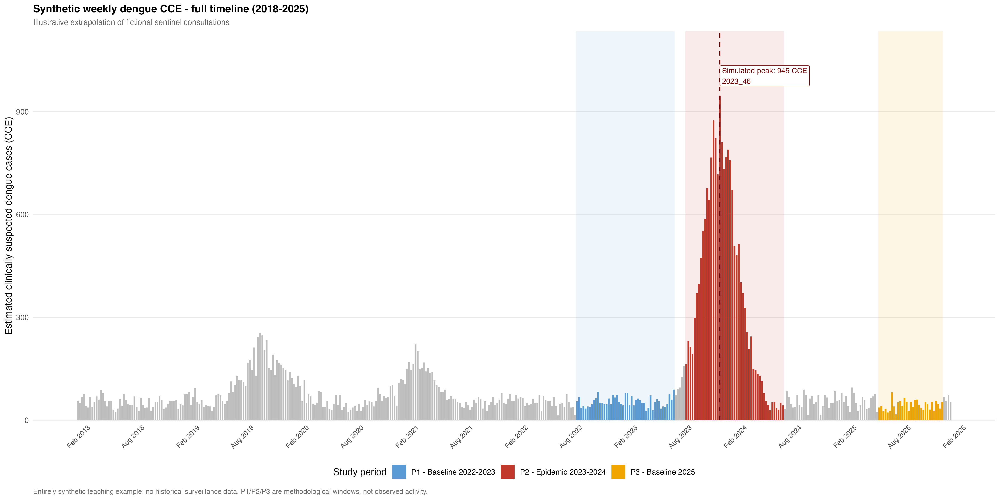
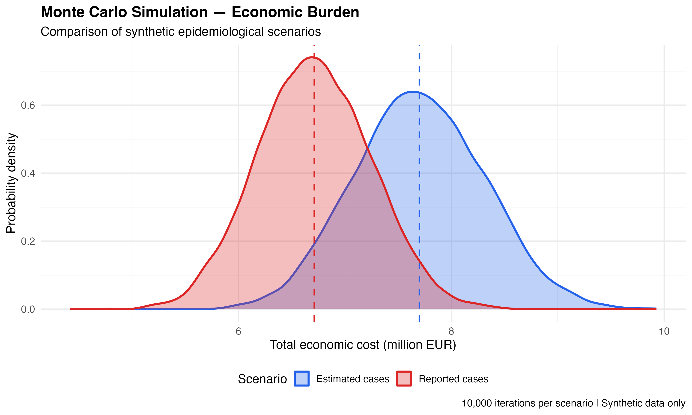

# Analyse médico-économique de la dengue en Martinique

### Épidémiologie · Biostatistique · Économie de la santé · Programmation R · Shiny

**Marie-Noëlle Nogeant**  
Master Santé publique – Méthodes quantitatives et économétriques pour la recherche en santé (MQERS)  
Aix-Marseille Université | 2026

**Langue :** [English](README.md) | **Français**

## Découvrir le projet

**📊 [Consulter le rapport scientifique – R & Quarto](https://mnngt.github.io/dengue-medico-economic-analysis/reports/scientific_case_study.html)**

**🖥️ [Ouvrir le tableau de bord interactif – R Shiny](https://mnngt-epi.shinyapps.io/dengue-surveillance-dashboard/)**

Le rapport scientifique, actuellement disponible en anglais, présente les méthodes, résultats, interprétations et limites de l'étude de cas. Le tableau de bord permet d'explorer de manière interactive des données de surveillance entièrement synthétiques.

> **Important :** toutes les analyses publiées reposent sur des données synthétiques. Ce dépôt ne contient ni données originales de surveillance, ni données à accès restreint, ni estimations validées du coût économique de la dengue en Martinique.

---

## Présentation du projet

Ce projet présente un cadre analytique reproductible permettant d'explorer les dimensions épidémiologiques et médico-économiques des épidémies de dengue à l'aide du langage R.

Inspiré des travaux méthodologiques réalisés durant mon stage de 2026 à Santé publique France Antilles, il rassemble des démonstrations portant sur la surveillance épidémiologique, le recours aux soins, l'analyse des remboursements, l'activité des laboratoires et la modélisation probabiliste des coûts.

Il comprend également un rapport scientifique réalisé avec Quarto et un tableau de bord interactif de surveillance épidémiologique développé avec R Shiny.

Les cinq modules analytiques constituent des démonstrations méthodologiques indépendantes : ils ne forment pas un modèle unique et validé d'estimation du coût d'une épidémie.

## Réalisations principales

### Rapport scientifique – R & Quarto

**[Lire le rapport scientifique en ligne](https://mnngt.github.io/dengue-medico-economic-analysis/reports/scientific_case_study.html)**  
**[Consulter le code source Quarto](reports/scientific_case_study.qmd)**

*Un cadre reproductible pour l'analyse épidémiologique et médico-économique de la dengue en Martinique : étude de cas sur données synthétiques.*

Le rapport scientifique, rédigé en anglais, expose le plan d'étude, la méthodologie, les résultats, la discussion et les conclusions. Il comprend **14 figures scientifiques**.

Il aborde la surveillance épidémiologique, l'analyse des remboursements de soins, les dépenses pharmaceutiques, l'activité des laboratoires de diagnostic et la modélisation probabiliste du coût de la maladie.

Il inclut également une reconstruction synthétique de courbes comparatives de surveillance de la dengue, de la grippe, de la COVID-19 et de la bronchiolite.

Le rapport HTML est publié sur GitHub Pages et peut être consulté directement dans un navigateur.

### Tableau de bord épidémiologique interactif – R Shiny

**[Ouvrir le tableau de bord Shiny](https://mnngt-epi.shinyapps.io/dengue-surveillance-dashboard/)**  
**[Consulter le code source Shiny](shiny/app.R)**  
**[Consulter la documentation Shiny](shiny/README.md)**

Cette application interactive de surveillance épidémiologique a été développée avec R Shiny, ggplot2 et des données de surveillance synthétiques.

Elle propose :

- La sélection interactive d'indicateurs épidémiologiques.
- La comparaison de trois périodes d'étude prédéfinies (P1, P2 et P3).
- Des courbes épidémiologiques hebdomadaires et des visualisations en temps calendaire.
- Des indicateurs clés de performance (KPI) dynamiques.
- La comparaison de l'activité hebdomadaire moyenne de surveillance.
- Des résumés statistiques descriptifs.
- Une évaluation automatisée de la qualité des données.
- Des filtres interactifs par période épidémiologique et par semaine.
- L'exportation des données et des résumés statistiques au format CSV.
- L'exportation des visualisations scientifiques au format PNG.

L'application illustre l'intégration de la gestion, de la validation, de l'analyse, de la visualisation et de la restitution interactive des données dans un flux de travail R reproductible.

Toutes les observations sont synthétiques et ne correspondent pas à des données réelles de surveillance en Martinique.

---

## Ressources du dépôt

| Ressource | Description |
|---|---|
| [Rapport scientifique – lecture en ligne](https://mnngt.github.io/dengue-medico-economic-analysis/reports/scientific_case_study.html) | Étude de cas scientifique complète, accessible via GitHub Pages (en anglais) |
| [Tableau de bord Shiny interactif](https://mnngt-epi.shinyapps.io/dengue-surveillance-dashboard/) | Application de surveillance épidémiologique en ligne |
| [Source Quarto](reports/scientific_case_study.qmd) | Fichier source modifiable du rapport scientifique |
| [Application Shiny](shiny/) | Code source, données synthétiques et documentation de l'application |
| [Documentation technique](TECHNICAL_DOCUMENTATION.md) | Méthodes, traitements analytiques, résultats et reproductibilité |
| [Scripts R](R/) | Code source de neuf traitements analytiques |
| [Figures](outputs/figures/) | Visualisations épidémiologiques et médico-économiques |
| [Tableaux de résultats](outputs/tables/) | Résultats statistiques et économiques exportés |

---

## Objectifs scientifiques

Ce projet explore les possibilités suivantes :

- Analyser les indicateurs de surveillance de la dengue et comparer les périodes épidémiologiques.
- Estimer des différences descriptives dans les nombres de cas et le recours aux soins.
- Traiter des données de remboursement des soins et des médicaments.
- Étudier l'activité des laboratoires de diagnostic et les composantes économiques associées.
- Examiner les coûts directs et indirects dans un cadre hypothétique d'évaluation du coût de la maladie.
- Quantifier l'incertitude économique au moyen de simulations probabilistes.
- Vérifier la qualité et la cohérence des jeux de données épidémiologiques.
- Développer des outils interactifs d'exploration de données épidémiologiques.
- Communiquer les résultats analytiques au moyen de rapports scientifiques reproductibles.

---

## Modules analytiques

| Module | Sujet principal |
|---|---|
| **01 — Épidémiologie** | Surveillance de la dengue, comparaisons entre maladies, indicateurs de recours aux soins et d'hospitalisation par âge |
| **02 — OpenDamir** | Analyse des remboursements de soins |
| **03 — OpenMedic** | Analyse des dépenses pharmaceutiques |
| **04 — Coûts de laboratoire** | Tests diagnostiques, recettes et activité sous-traitée |
| **05 — Monte-Carlo** | Modélisation du coût de la maladie, incertitude et analyses de sensibilité |

Le dépôt comprend **neuf scripts analytiques R**, organisés en cinq modules scientifiques.

Ces modules illustrent des approches méthodologiques complémentaires et ne sont pas assemblés en une estimation unique et validée du coût économique de la dengue.

---

## Visualisations sélectionnées

### Surveillance épidémiologique

Simulation hebdomadaire de la surveillance de la dengue illustrant les périodes d'étude, les tendances temporelles et les dynamiques épidémiques.



### Analyse économique probabiliste

Simulations de Monte-Carlo illustrant l'incertitude dans un scénario synthétique d'estimation du coût de la maladie.



### Surveillance épidémiologique interactive

Le tableau de bord Shiny complète les résultats statiques en permettant d'explorer de manière interactive des indicateurs de surveillance synthétiques.

**[Explorer le tableau de bord en ligne](https://mnngt-epi.shinyapps.io/dengue-surveillance-dashboard/)**

*Toutes les observations et toutes les valeurs économiques illustrées sont fictives. Elles ne doivent pas être interprétées comme des estimations épidémiologiques ou financières officielles.*

---

## Compétences techniques mises en œuvre

**Programmation statistique :** R, data.table, dplyr, tidyr.

**Analyse épidémiologique :** comparaisons temporelles, alignement des semaines ISO, indicateurs descriptifs, analyses stratifiées par âge, recours aux soins et indicateurs de surveillance.

**Économie de la santé :** traitement des remboursements de soins, méthodes d'estimation du coût de la maladie, coûts directs et indirects.

**Modélisation statistique :** simulations de Monte-Carlo, quantification de l'incertitude et analyses de sensibilité.

**Visualisation scientifique :** ggplot2, patchwork, courbes épidémiques, graphiques comparatifs et production reproductible de figures scientifiques.

**Applications interactives :** R Shiny, programmation réactive, filtres interactifs, indicateurs dynamiques et sorties téléchargeables.

**Gestion et contrôle qualité des données :** importation, validation des variables, détection des valeurs manquantes et des doublons, contrôles de cohérence et agrégations descriptives.

**Rédaction scientifique :** Quarto, Markdown, HTML, notation mathématique, interprétation scientifique et figures avec renvois croisés.

**Pratiques de recherche :** documentation analytique, flux de travail reproductibles, gestion des versions, Git et GitHub.

---

## Reproductibilité

Les scripts analytiques R génèrent ou traitent des jeux de données synthétiques, puis exportent les résultats statistiques sous forme de tableaux CSV et de figures scientifiques.

Le fichier source Quarto utilise les figures produites pour générer un rapport scientifique HTML autonome.

L'application Shiny exploite un jeu de données épidémiologiques synthétiques inclus dans son propre répertoire, ce qui permet l'exploration interactive des indicateurs de surveillance.

Pour lancer localement l'application Shiny depuis la racine du projet :

```r
shiny::runApp("shiny")
```

Les packages R nécessaires à l'application Shiny comprennent notamment `shiny` et `ggplot2`.

Certains scripts analytiques dépendent encore de fichiers intermédiaires synthétiques produits par d'autres modules, et certains chemins locaux doivent être adaptés.

Le dépôt constitue donc un **portfolio méthodologique**, et non une chaîne de recherche entièrement automatisée et portable sans adaptation.

Pour les instructions d'exécution détaillées, les limites méthodologiques et les sorties disponibles, consulter la [documentation technique](TECHNICAL_DOCUMENTATION.md).

Pour les instructions propres à l'application, consulter la [documentation Shiny](shiny/README.md).

---

## Développements envisagés

Les améliorations possibles comprennent :

- **Reproductibilité :** amélioration de la portabilité, gestion des dépendances et tests automatisés de validation.
- **Flux de travail R :** modularisation et automatisation supplémentaires des scripts analytiques.
- **Méthodes statistiques :** démonstrations méthodologiques complémentaires sur des données épidémiologiques synthétiques.
- **Python et SQL :** extensions éventuelles pour le traitement et la validation des données dans plusieurs langages.

Le rapport scientifique Quarto et l'application interactive R Shiny sont déjà réalisés et accessibles publiquement.

Les développements ultérieurs pourraient viser à renforcer la robustesse, la documentation méthodologique et la reproductibilité des analyses.

---

## À propos de l'autrice

Je suis titulaire d'un master en Santé publique, spécialité Méthodes quantitatives et économétriques pour la recherche en santé (MQERS), obtenu à Aix-Marseille Université.

Mon parcours universitaire comprend également des licences en mathématiques et en physique-chimie, ainsi que deux années d'études de médecine.

Mes domaines d'intérêt professionnel incluent l'épidémiologie, la biostatistique, l'économie de la santé, la science des données, la surveillance des maladies infectieuses, la recherche clinique et la programmation scientifique reproductible.

**GitHub :** [MNNGT](https://github.com/MNNGT)

---

**Avertissement :** ce dépôt constitue une démonstration méthodologique indépendante fondée sur des données synthétiques. Il ne s'agit ni d'une publication officielle de Santé publique France, ni d'une analyse de données réelles de patients ou de surveillance épidémiologique.
