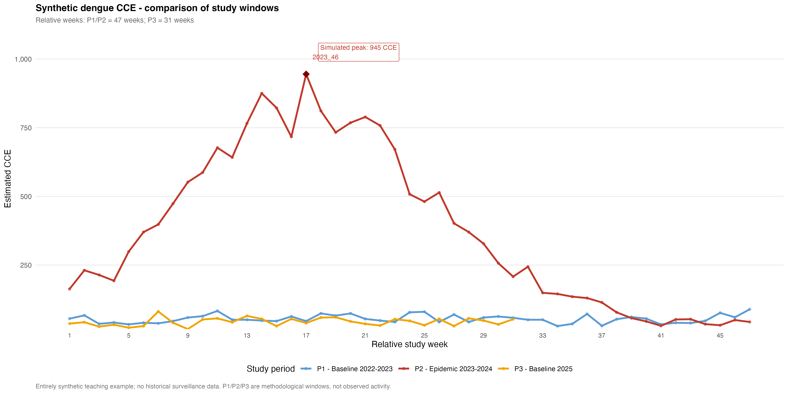
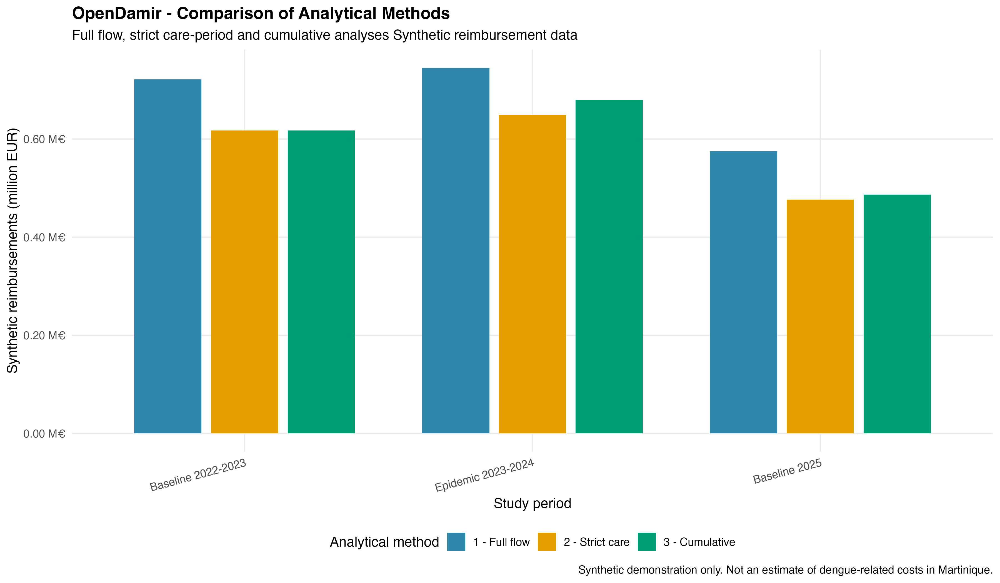
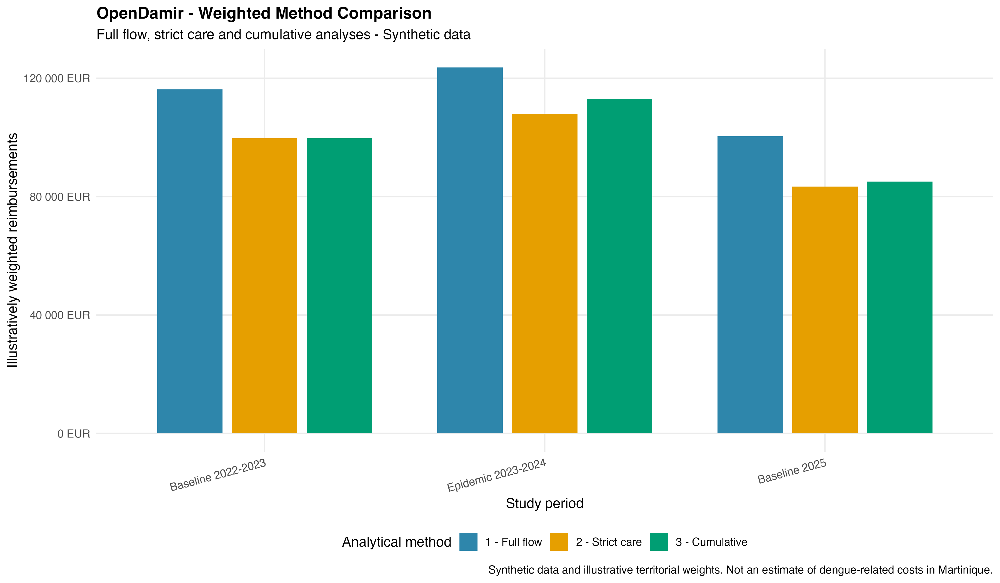
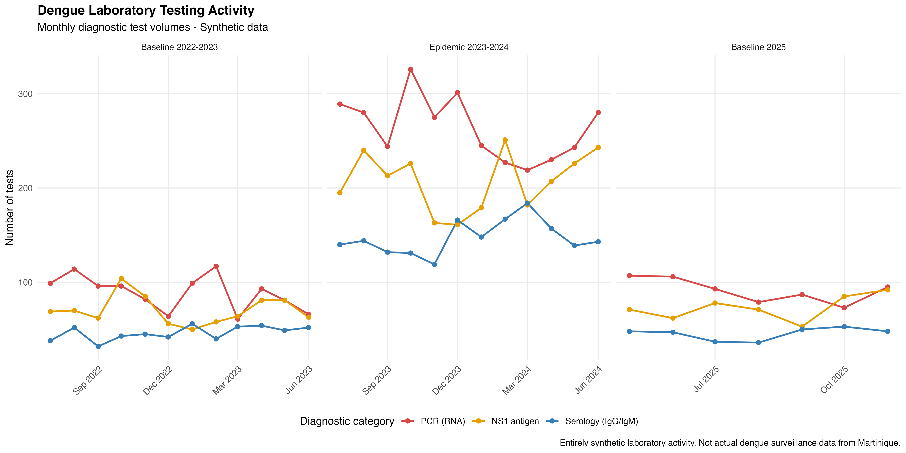
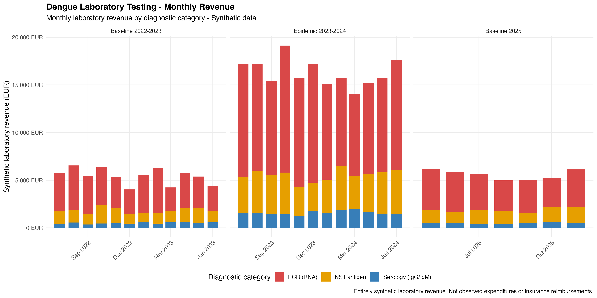
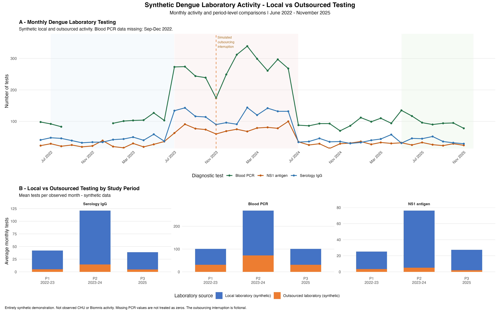

# Dengue Medico-Economic Analysis in Martinique

### Epidemiology | Health Economics | R Programming | Uncertainty Analysis

**Author:** Marie-Noëlle Nogeant  
**Education:** Master's Degree in Public Health – Quantitative and Econometric Methods for Health Research (MQERS), Aix-Marseille University  
**Year:** 2026

---

## Project Overview

This repository presents a reproducible, R-based demonstration of methods used in the medico-economic analysis of dengue epidemics.

It is inspired by analytical work conducted during my 2026 public health internship at Santé publique France, Antilles, focusing on the economic burden of the 2023–2024 dengue epidemic in Martinique.

The project explores how epidemiological indicators, healthcare reimbursement data, pharmaceutical expenditure, laboratory testing costs, and probabilistic simulations can be integrated into a cost-of-illness framework.

**Important:** This public portfolio uses synthetic data and illustrative assumptions. It does not reproduce confidential datasets, official surveillance results, or validated estimates of dengue-related costs in Martinique.

---

## Research Objectives

The project aims to demonstrate methods for:

- Analyzing epidemiological trends and epidemic periods.
- Estimating excess healthcare utilization and associated costs.
- Processing and analyzing large-scale healthcare reimbursement datasets.
- Examining pharmaceutical expenditure and laboratory testing costs.
- Integrating direct and indirect costs into a cost-of-illness framework.
- Quantifying uncertainty through Monte Carlo simulations.
- Producing reproducible statistical analyses and visualizations using R.

---

## Analytical Modules

The project is organized around five complementary modules.

| Module | Analytical Focus | Status |
|---|---|---|
| 01. Epidemiological Analysis | Weekly dengue surveillance, study-period comparisons, exploratory excess CCE and healthcare utilization | Available — synthetic demonstration |
| 02. OpenDamir | Healthcare reimbursement processing and cost estimation methods | Available — synthetic demonstration |
| 03. OpenMedic | Pharmaceutical reimbursement analysis and ATC classification | Available — synthetic demonstration |
| 04. Laboratory Costs | Diagnostic testing activity, laboratory revenue, local and outsourced testing | Available — two synthetic workflows |
| 05. Monte Carlo Simulation | Probabilistic uncertainty and sensitivity analyses | Available — synthetic demonstration |

All five modules are available as independent synthetic demonstrations of analytical methods adapted from previously developed research workflows. They are not yet an integrated or validated economic model.

---

## Epidemiological Analysis — Synthetic Dengue Surveillance

This module demonstrates reproducible weekly epidemiological surveillance analyses using **entirely synthetic data**. It adapts selected methods from my research on dengue in Martinique while keeping original public-health surveillance datasets and findings out of the public repository.

The simulated series spans **417 ISO-week observations from 2018 to 2025**. Calendar dates identify illustrative study windows and do not represent observed outbreak timing or severity.

### Analytical Workflow

The R pipeline includes:

- Generating fictional weekly sentinel consultation counts and illustrative extrapolated clinically suspected dengue cases (**CCE**).
- Constructing exact ISO-week calendars and classifying three study periods.
- Identifying the maximum simulated weekly CCE count within the epidemic-period scenario.
- Comparing study periods on a relative-week scale.
- Computing an illustrative week-matched **P2 − P1** difference in estimated CCE.
- Generating separate fictional dengue biological-case, influenza, bronchiolitis and COVID-19 indicators.
- Applying centered three-week moving averages and per-series min–max normalization for exploratory comparison of temporal patterns.
- Summarizing exploratory active weeks using a threshold of 25% of each normalized series' own range.
- Comparing fictional dengue-related emergency-department visits and hospital admissions.
- Exporting quality checks, analytical tables and publication-ready figures.

### Study Periods

| Period | ISO-week window | Duration | Role in the demonstration |
|---|---|---:|---|
| P1 | 2022 W30 – 2023 W24 | 47 weeks | Baseline scenario |
| P2 | 2023 W30 – 2024 W24 | 47 weeks | Epidemic scenario |
| P3 | 2025 W18 – W48 | 31 weeks | Additional baseline scenario |

**P3 is shorter than P1 and P2.** Its raw cumulative counts should not be directly compared with 47-week totals without accounting for the difference in observation duration.

### Illustrative Results

| Indicator | Synthetic result |
|---|---:|
| Weekly observations, 2018–2025 | 417 |
| Maximum weekly CCE in P2 | 945 |
| ISO week of the simulated P2 peak | 2023 W46 |
| Matched weeks in P1/P2 comparison | 47 |
| Net simulated difference, P2 − P1 | 15,371 CCE |

The **15,371 CCE** value is an arithmetic difference between two simulated 47-week series. It is **not** an official estimate of excess dengue cases, a causal effect, or a validated estimate of disease burden in Martinique.

Biologically confirmed/probable cases and extrapolated sentinel CCE are treated as **distinct indicators**; comparisons of normalized trajectories do not imply equivalent detection methods or comparable absolute case counts.

The 25% activity rule is an **exploratory descriptive threshold**, not an official epidemic-alert threshold. The generated dengue, influenza, bronchiolitis and COVID-19 patterns are fictional.

### Visualizations

**Weekly dengue CCE timeline with highlighted study periods and simulated peak**

**Comparison of study periods using relative weeks**

**Additional figures**

- [Comparative disease dynamics — two dengue indicators, influenza, bronchiolitis and COVID-19](outputs/figures/epidemiology_disease_dynamics_synthetic.png)
- [Relative epidemic-intensity heatmap](outputs/figures/epidemiology_intensity_heatmap_synthetic.png)
- [Exploratory active weeks by period and disease](outputs/figures/epidemiology_active_weeks_synthetic.png)
- [Illustrative matched-week excess CCE comparison](outputs/figures/epidemiology_excess_cce_synthetic.png)

### Code and Results

**R script**

- [Complete synthetic epidemiological analysis](R/epidemiological_analysis_synthetic.R)

**Output tables**

- [Summary of the three study periods](outputs/tables/epidemiology_period_summary_synthetic.csv)
- [Week-matched P1/P2 CCE differences](outputs/tables/epidemiology_weekly_excess_synthetic.csv)
- [Illustrative excess CCE summary](outputs/tables/epidemiology_excess_summary_synthetic.csv)
- [Relative-week surveillance indicators](outputs/tables/epidemiology_relative_weeks_synthetic.csv)
- [Annual disease indicators](outputs/tables/epidemiology_annual_disease_summary_synthetic.csv)
- [Exploratory active-week analysis](outputs/tables/epidemiology_active_weeks_synthetic.csv)
- [Synthetic healthcare utilization indicators](outputs/tables/epidemiology_healthcare_utilization_synthetic.csv)
- [Data-quality summary](outputs/tables/epidemiology_data_quality_synthetic.csv)

The underlying synthetic weekly surveillance dataset is regenerated by the R script and excluded from version control through `.gitignore`.

---

## OpenDamir — Synthetic Reimbursement Data Analysis

This module demonstrates an automated healthcare reimbursement data processing workflow using R and `data.table`.

It is adapted from methodological work conducted during my public health research internship.

### Analytical Workflow

The pipeline includes:

- Generation and processing of 25 synthetic monthly datasets.
- Selective import of healthcare reimbursement variables.
- Geographic and ambulatory care filtering.
- Classification of 19 healthcare service codes into four analytical categories.
- Automated quality checks and exclusion tracking.
- Identification and handling of negative reimbursement amounts.
- Classification of reimbursement flow dates and actual care dates.
- Comparison of three analytical approaches.
- Illustrative year-specific territorial weighting.

The demonstration includes **37,500 initial synthetic observations**, of which **19,491 remain after filtering**.

### Analytical Methods

Three complementary approaches are implemented:

| Method | Description |
|---|---|
| Full flow | Includes eligible reimbursements from selected monthly files |
| Strict care period | Retains care delivered within the corresponding study period |
| Cumulative | Includes care from the current and authorized previous study periods |

Synthetic reimbursement delays were introduced to demonstrate differences between these methods.

The selected healthcare service codes represent an analytical basket. They do not independently identify dengue diagnoses or establish that reimbursements are attributable to dengue.

### Illustrative Results

After applying fictional territorial weighting coefficients, the cumulative method exceeds the strict care-period method by:

- **EUR 4,918.12** for the 2023–2024 epidemic-period scenario.
- **EUR 1,692.38** for the 2025 baseline scenario.

These differences illustrate the methodological impact of delayed reimbursements.

**All results and coefficients are illustrative and must not be interpreted as actual healthcare expenditure estimates for Martinique.**

### Visualizations

**Comparison of the three analytical methods**

**Comparison after illustrative territorial weighting**

### Code and Results

**R script**

- [Complete OpenDamir analysis workflow](R/opendamir_synthetic.R)

**Output tables**

- [Processing quality tracking](outputs/tables/opendamir_processing_tracking_synthetic.csv)
- [Healthcare category summary](outputs/tables/opendamir_category_summary_synthetic.csv)
- [Method comparison](outputs/tables/opendamir_method_comparison_synthetic.csv)
- [Method totals](outputs/tables/opendamir_method_totals_synthetic.csv)
- [Territorial weighting summary](outputs/tables/opendamir_territorial_weighting_synthetic.csv)
- [Weighted method comparison](outputs/tables/opendamir_weighted_comparison_synthetic.csv)
- [Weighted method totals](outputs/tables/opendamir_weighted_method_totals_synthetic.csv)

The 25 intermediate synthetic CSV files are generated automatically by the R script and excluded from version control.

---

## OpenMedic — Synthetic Pharmaceutical Expenditure Analysis

This module demonstrates pharmaceutical reimbursement data processing and expenditure analysis using synthetic observations.

### Analytical Workflow

The workflow includes:

- Reproducible generation of synthetic pharmaceutical data.
- Classification of simulated observations by ATC5 code.
- Filtering and aggregation of reimbursement records.
- Calculation of annual reimbursements and dispensing totals.
- Application of an illustrative geographic allocation coefficient.
- Comparison with a reference year.
- Visualization of annual expenditure.

The allocation coefficient and reimbursement amounts are illustrative and do not represent validated pharmaceutical expenditure estimates for Martinique.

### Visualization

*Illustrative pharmaceutical expenditure results generated from synthetic data.*

### Code

- [OpenMedic synthetic analysis](R/openmedic_analyse_synthetique.R)

---

## Laboratory Costs — Synthetic Diagnostic Testing Analysis

This module presents two complementary analytical workflows inspired by laboratory data processing undertaken during my public health internship.

The first focuses on laboratory testing activity and associated revenue. The second examines local versus outsourced diagnostic testing, monthly trends, and data completeness.

**All observations, test volumes, financial amounts, and laboratory activity scenarios are synthetic or illustrative.**

### Part A — Laboratory Testing and Revenue Analysis

This workflow demonstrates the processing and economic analysis of dengue diagnostic testing activity, inspired by laboratory reporting data.

#### Analytical Workflow

The workflow includes:

- Generation and consolidation of three synthetic laboratory datasets covering 2022–2025.
- Classification of diagnostic tests into PCR (RNA), NS1 antigen and serology (IgG/IgM).
- Monthly aggregation of test volumes and laboratory revenue.
- Calculation of theoretical revenue using illustrative B-point values.
- Quality checks comparing simulated and theoretical revenue.
- Comparisons across baseline and epidemic-period scenarios.
- Adjustment for differences in study-period duration using monthly averages.

The demonstration contains **93 monthly test-category records**, representing **11,353 simulated examinations**.

#### Illustrative Results

| Study period | Average monthly tests | Average monthly revenue |
|---|---:|---:|
| Baseline 2022–2023 | 206 | EUR 5,434 |
| Epidemic 2023–2024 | 618 | EUR 16,282 |
| Baseline 2025 | 210 | EUR 5,583 |

In this synthetic scenario, testing activity is approximately three times higher during the epidemic period, reflecting the assumptions used in data generation.

The overall simulated laboratory revenue is approximately **EUR 299,678**.

These results are not observed laboratory expenditures in Martinique. Laboratory revenue is not necessarily equivalent to health insurance reimbursements.

#### Visualizations

**Monthly diagnostic testing activity**

**Monthly laboratory revenue by test category**

#### Code and Results

**R script**

- [Laboratory testing and revenue workflow](R/laboratory_costs_synthetic.R)

**Output tables**

- [Revenue consistency checks](outputs/tables/laboratory_revenue_quality_synthetic.csv)
- [Economic summary by study period](outputs/tables/laboratory_period_summary_synthetic.csv)
- [Results by diagnostic test and period](outputs/tables/laboratory_test_period_summary_synthetic.csv)
- [Comparison with baseline](outputs/tables/laboratory_baseline_comparison_synthetic.csv)
- [Monthly testing volumes](outputs/tables/laboratory_monthly_volumes_synthetic.csv)
- [Monthly laboratory revenue](outputs/tables/laboratory_monthly_revenue_synthetic.csv)

The three intermediate synthetic laboratory datasets are generated automatically by the R script and excluded from version control.

### Part B — CHU / Biomnis: Local vs Outsourced Laboratory Activity

This complementary workflow demonstrates the analysis of diagnostic testing performed locally versus outsourced to an external laboratory.

It is methodologically inspired by laboratory activity analyses involving the CHU of Martinique and Biomnis.

The public implementation uses entirely synthetic observations and does not reproduce actual laboratory activity, patient information, or confidential reporting data.

#### Analytical Workflow

The workflow includes:

- Generation of synthetic monthly testing data from June 2022 to November 2025.
- Classification into four diagnostic categories: blood PCR, cerebrospinal fluid (CSF) PCR, NS1 antigen, and IgG serology.
- Distinction between local and outsourced laboratory activity.
- Monthly aggregation of diagnostic testing volumes.
- Comparison of testing activity across three study periods.
- Assessment of data completeness and missing observations.
- Simulation of an illustrative interruption in outsourced testing activity.
- Automated quality checks and reproducible graphical reporting.

The demonstration covers **42 months**, with four diagnostic categories and two laboratory sources.

The full synthetic dataset contains **336 source-level monthly records**.

#### Handling Missing Laboratory Data

The workflow explicitly models unavailable PCR observations between September and December 2022.

Missing values are preserved as `NA` rather than being replaced with zero.

This distinction prevents unavailable measurements from being incorrectly interpreted as an absence of diagnostic testing.

The analysis also calculates data completeness indicators by diagnostic category, laboratory source, and study period.

#### Local vs Outsourced Testing

Laboratory activity is separated into two illustrative sources:

- **Local laboratory:** diagnostic tests performed within the local laboratory setting.
- **Outsourced laboratory:** diagnostic tests referred to an external laboratory.

An artificial outsourcing interruption is introduced in November 2023 to demonstrate how operational disruptions may affect the distribution of testing activity.

**This interruption is entirely fictional and must not be interpreted as a documented event involving Biomnis or the CHU of Martinique.**

Comparisons between study periods use average monthly testing volumes to account for differences in observation duration and data availability.

#### Scientific Visualization

The workflow produces a combined two-panel figure:

**Panel A — Monthly Diagnostic Testing Activity**

Monthly trends for blood PCR, NS1 antigen, and IgG serology, with study-period shading, missing-data gaps, and an illustrative outsourcing interruption.

**Panel B — Local vs Outsourced Laboratory Activity**

Stacked bar charts comparing average monthly testing activity between local and outsourced laboratory sources across the three study periods.

*Two-panel visualization generated entirely from synthetic laboratory activity data.*

#### Code and Results

**R script**

- [CHU / Biomnis synthetic laboratory workflow](R/laboratory_chu_biomnis_synthetic.R)

**Output tables**

- [Monthly diagnostic testing activity](outputs/tables/laboratory_chu_biomnis_monthly_synthetic.csv)
- [Laboratory activity by period and source](outputs/tables/laboratory_chu_biomnis_period_synthetic.csv)
- [Laboratory data completeness analysis](outputs/tables/laboratory_chu_biomnis_missingness_synthetic.csv)

The synthetic source-level dataset is generated automatically and excluded from version control.

#### Methodological Scope

The two laboratory workflows illustrate complementary analytical questions.

The first examines diagnostic testing volumes, theoretical tariffs, and simulated laboratory revenue.

The second examines the organization of laboratory testing activity, differences between local and outsourced services, and the handling of incomplete observations.

They are independent synthetic demonstrations and should not be interpreted as a combined estimate of laboratory costs or dengue-related healthcare expenditure in Martinique.

---

## Monte Carlo — Probabilistic Cost-of-Illness Analysis

This module demonstrates a probabilistic cost-of-illness analysis using R and **10,000 Monte Carlo iterations**.

Adapted from my Master's research methodology, it combines direct healthcare costs and indirect productivity losses under uncertainty.

### Statistical Methods

The simulation includes:

- Normal distributions for healthcare expenditures and excess cases.
- Triangular distributions for hospital stays and sick leave durations.
- Uniform distributions for non-reimbursed medication assumptions.
- Estimation of direct, indirect, and total economic costs.
- Comparison of alternative epidemiological scenarios.
- One-way sensitivity analyses of wages and sick leave duration.

### Illustrative Results

The synthetic baseline scenario produced:

| Indicator | Simulated Result |
|---|---|
| Mean total cost | EUR 7.700 million |
| Median total cost | EUR 7.693 million |
| 95% simulation interval | EUR 6.537–8.911 million |
| Direct cost contribution | 84.9% |
| Indirect cost contribution | 15.1% |

**These results are entirely synthetic and must not be interpreted as actual estimates of the economic burden of dengue in Martinique.**

### Visualizations

**Monte Carlo cost distributions**

**Additional visualizations**

- [Input variable distributions](outputs/figures/monte_carlo_input_distributions.png)
- [Direct and indirect cost breakdown](outputs/figures/monte_carlo_cost_breakdown_synthetic.png)
- [One-way sensitivity analysis](outputs/figures/monte_carlo_tornado_synthetic.png)

### Code and Results

- [Complete R simulation script](R/monte_carlo_synthetic.R)
- [Scenario comparison](outputs/tables/monte_carlo_scenario_comparison.csv)
- [Cost breakdown](outputs/tables/monte_carlo_cost_breakdown.csv)
- [Sensitivity analysis](outputs/tables/monte_carlo_sensitivity_analysis.csv)

The simulation uses a fixed random seed and does not require confidential datasets.

---

## Tools and Methods

**Programming and data processing**

- R and RStudio
- `data.table`, `dplyr` and `tidyr`
- Data cleaning, filtering, aggregation and transformation
- Automated processing workflows
- Data quality checks and validation
- Handling of missing observations

**Statistical and economic analysis**

- Descriptive statistics and epidemiology
- Healthcare expenditure analysis
- Reference-period comparisons
- Cost-of-illness methodology
- Laboratory activity and revenue analysis
- Probabilistic simulation
- Uncertainty and sensitivity analyses
- Illustrative geographic allocation methods

**Reporting and visualization**

- `ggplot2` and `patchwork`
- R Markdown and reproducible reporting
- Statistical tables and graphical outputs
- CSV data exports
- Git and GitHub

Some methods listed above are planned extensions and have not yet been implemented in the public repository.

---

## Reproducibility

The available modules use synthetic data to demonstrate analytical workflows without exposing restricted research datasets.

### Getting Started

1. Clone or download this repository.
2. Open the project folder in RStudio.
3. Install the required R packages.
4. Open the relevant script in the `R/` directory.
5. Check any local file paths before execution.
6. Run the script to reproduce the corresponding synthetic analyses.

### Available Scripts

| Script | Purpose |
|---|---|
| `R/epidemiological_analysis_synthetic.R` | Synthetic epidemiological surveillance, study-period comparisons, relative dynamics and illustrative excess cases |
| `R/opendamir_synthetic.R` | Synthetic healthcare reimbursement processing and method comparison |
| `R/openmedic_analyse_synthetique.R` | Synthetic pharmaceutical reimbursement analysis |
| `R/laboratory_costs_synthetic.R` | Laboratory testing volumes, revenue and economic comparisons |
| `R/laboratory_chu_biomnis_synthetic.R` | Local versus outsourced testing, monthly activity and missing-data analysis |
| `R/monte_carlo_synthetic.R` | Probabilistic cost simulation and sensitivity analysis |

Random seeds are used to support reproducibility.

**Current limitation:** Some scripts still use local file paths, including the OpenDamir project directory. These paths must be adapted to the user's environment. A future update will improve portability through project-relative paths.

---

## Data Availability and Confidentiality

No restricted, individual-level, or confidential datasets from Santé publique France or its partners are included in this repository.

The publicly available demonstrations use artificially generated observations and illustrative parameters.

The original internship research and this public portfolio are distinct.

The CHU / Biomnis and laboratory revenue demonstrations do not contain original laboratory records.

**Synthetic outputs must not be interpreted as observed healthcare expenditures, official epidemiological estimates, or validated estimates of the economic burden of dengue.**

---

## Development Roadmap

The next development stages include:

- Refining synthetic epidemiological comparisons, reference-period assumptions and sensitivity analyses.
- Extending the laboratory diagnostic analysis workflows and methodological validation.
- Improving the portability of existing R scripts.
- Extending data validation and sensitivity analyses.
- Strengthening documentation and reproducible reporting.
- Integrating the complementary modules into a coherent cost-of-illness analytical framework.

---

## About the Author

I hold a Master's Degree in Public Health, specializing in Quantitative and Econometric Methods for Health Research (MQERS), from Aix-Marseille University.

My academic background also includes degrees in mathematics and physics-chemistry, as well as two years of medical studies.

My interests include epidemiology, health economics, biostatistics, scientific programming, public health research, and clinical research.

**GitHub:** [MNNGT](https://github.com/MNNGT)
