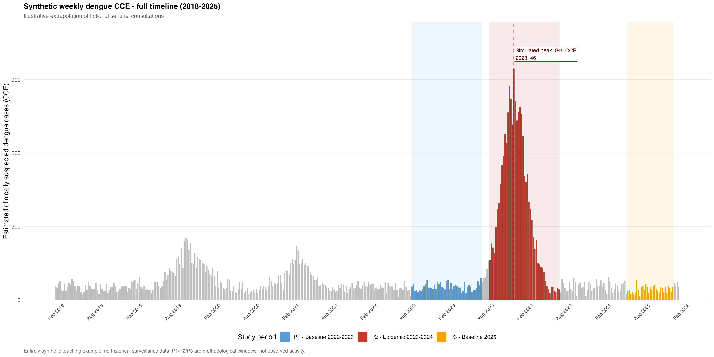
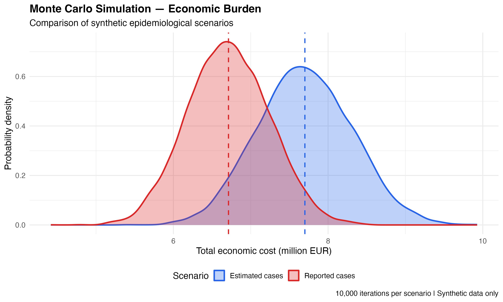

# Dengue Medico-Economic Analysis in Martinique

### Epidemiology · Biostatistics · Health Economics · R Programming

**Marie-Noëlle Nogeant**  
Master's Degree in Public Health – Quantitative and Econometric Methods for Health Research (MQERS)  
Aix-Marseille University | 2026

---

## Project Overview

This project demonstrates an end-to-end analytical framework for studying the epidemiological and medico-economic dimensions of dengue epidemics using R.

Inspired by methodological work conducted during my 2026 internship at Santé publique France, Antilles, the repository brings together epidemiological surveillance, healthcare utilization, reimbursement analysis, laboratory activity, and probabilistic cost modeling.

**All publicly available analyses use synthetic data.** The repository does not contain original surveillance observations, restricted datasets, or validated estimates of the economic burden of dengue in Martinique.

## Explore the Project

| Resource | Description |
|---|---|
| [Technical Documentation](TECHNICAL_DOCUMENTATION.md) | Detailed methodology, analytical workflows, results, figures and reproducibility |
| [R Scripts](R/) | Source code for nine reproducible analytical workflows |
| [Figures](outputs/figures/) | Epidemiological and medico-economic visualizations |
| [Results Tables](outputs/tables/) | Exported statistical and economic summaries |

*A scientific case study, Python analysis and interactive Shiny application are planned extensions.*

## Research Objectives

The project explores how to:

- Analyze dengue surveillance indicators and compare epidemiological periods.
- Estimate descriptive differences in case counts and healthcare utilization.
- Process healthcare and pharmaceutical reimbursement data.
- Evaluate diagnostic laboratory activity and associated costs.
- Combine direct and indirect costs in a cost-of-illness framework.
- Quantify economic uncertainty using probabilistic simulations.
- Communicate analytical findings through reproducible scientific reporting.

## Analytical Modules

| Module | Main Focus |
|---|---|
| **01 — Epidemiology** | Dengue surveillance, disease comparisons, age-stratified care and hospitalization indicators |
| **02 — OpenDamir** | Healthcare reimbursement analysis |
| **03 — OpenMedic** | Pharmaceutical expenditure analysis |
| **04 — Laboratory Costs** | Diagnostic testing, revenues and outsourced activity |
| **05 — Monte Carlo** | Cost-of-illness modeling, uncertainty and sensitivity analyses |

The repository includes **nine R scripts**, organized into five scientific modules.

## Selected Visualizations

### Epidemiological Surveillance

Weekly dengue surveillance simulation illustrating study periods, temporal trends and epidemic dynamics.

### Probabilistic Economic Analysis

Monte Carlo simulations illustrating uncertainty in a synthetic cost-of-illness scenario.

*All illustrated observations and economic amounts are fictional and should not be interpreted as official epidemiological or financial estimates.*

## Technical Skills Demonstrated

**Statistical programming:** R, data.table, dplyr, tidyr

**Epidemiological analysis:** Time-series comparisons, ISO-week alignment, descriptive indicators, age-stratified analysis

**Health economics:** Healthcare reimbursements, cost-of-illness methods, direct and indirect costs

**Statistical modeling:** Monte Carlo simulation, uncertainty and sensitivity analyses

**Scientific visualization:** ggplot2, patchwork, reproducible graphical reporting

**Research practices:** Data validation, analytical documentation, reproducible workflows, Git and GitHub

## Reproducibility

The R scripts generate or process synthetic datasets and export results as CSV tables and scientific figures.

Some scripts depend on synthetic intermediate files created by other modules, and certain local paths still require adaptation.

For detailed execution instructions, methodological limitations and available outputs, see the [Technical Documentation](TECHNICAL_DOCUMENTATION.md).

## Next Developments

- **Quarto:** Scientific case study with structured methods, results and discussion.
- **Python:** Cross-language data processing and validation of selected R analyses.
- **Shiny:** Interactive epidemiological dashboard for exploring synthetic indicators.
- **Reproducibility:** Improved project portability and automated checks.

These extensions are planned and are not yet part of the published implementation.

## About the Author

I hold a Master's Degree in Public Health, specializing in Quantitative and Econometric Methods for Health Research (MQERS), from Aix-Marseille University.

My academic background includes degrees in mathematics and physics-chemistry, as well as two years of medical studies.

My professional interests include epidemiology, biostatistics, health economics, data science, clinical research and reproducible scientific programming.

**GitHub:** [MNNGT](https://github.com/MNNGT)

---

**Disclaimer:** This repository is an independent synthetic methodological demonstration, not an official Santé publique France publication or an analysis of actual patient or surveillance data.
