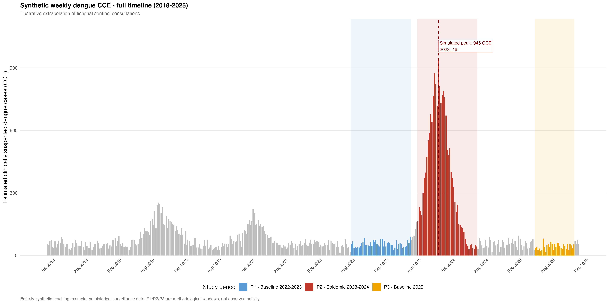
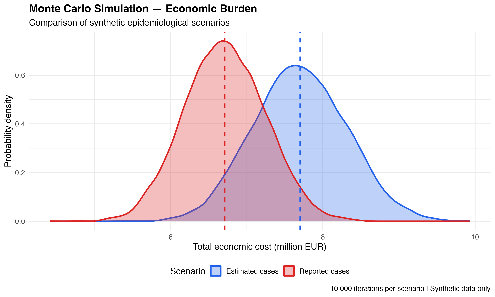

# Dengue Medico-Economic Analysis in Martinique

### Epidemiology · Biostatistics · Health Economics · R Programming · Shiny

**Marie-Noëlle Nogeant**  
Master's Degree in Public Health – Quantitative and Econometric Methods for Health Research (MQERS)  
Aix-Marseille University | 2026

---

## Project Overview

This project demonstrates a reproducible analytical framework for exploring the epidemiological and medico-economic dimensions of dengue epidemics using R.

Inspired by methodological work conducted during my 2026 internship at Santé publique France, Antilles, the repository brings together epidemiological surveillance, healthcare utilization, reimbursement analysis, laboratory activity, and probabilistic cost modeling.

The project also includes a scientific report developed with Quarto and an interactive epidemiological surveillance dashboard developed with R Shiny.

**All publicly available analyses use synthetic data.** The repository does not contain original surveillance observations, restricted datasets, or validated estimates of the economic burden of dengue in Martinique.

The five analytical modules are independent methodological demonstrations rather than components of a single validated economic estimation model.

## Featured Projects

### Scientific Research Report — R & Quarto

**[Read the Scientific Report Online](https://mnngt.github.io/dengue-medico-economic-analysis/reports/scientific_case_study.html)**

**[View the Quarto Source Code](reports/scientific_case_study.qmd)**

*A Reproducible Framework for Epidemiological and Medico-Economic Analysis of Dengue in Martinique: A Synthetic Data Case Study*

The English-language scientific report presents the study design, methodology, results, discussion, conclusions, and **14 scientific figures**.

It covers epidemiological surveillance, healthcare reimbursement analysis, pharmaceutical expenditure, diagnostic laboratory activity, and probabilistic cost-of-illness modeling.

The report also includes a synthetic reconstruction of comparative surveillance curves for dengue, influenza, COVID-19, and bronchiolitis.

The HTML report is published through GitHub Pages and can be consulted directly in a web browser.

### Interactive Epidemiological Dashboard — R Shiny

**[Launch the Interactive Shiny Dashboard](https://mnngt-epi.shinyapps.io/dengue-surveillance-dashboard/)**

**[View the Shiny Source Code](shiny/app.R)**

**[View the Shiny Documentation](shiny/README.md)**

An interactive epidemiological surveillance application developed with R Shiny, ggplot2, and synthetic surveillance data.

The dashboard includes:

- Interactive selection of epidemiological indicators.
- Comparison of three predefined study periods (P1, P2, and P3).
- Weekly epidemiological curves and calendar-time visualizations.
- Dynamic key performance indicators (KPIs).
- Comparison of average weekly surveillance activity.
- Descriptive statistical summaries.
- Automated data quality assessment.
- Interactive filters for epidemiological periods and weeks.
- CSV exports of data and statistical summaries.
- PNG exports of scientific visualizations.

The application demonstrates the integration of data management, validation, analysis, visualization, and interactive reporting within a reproducible R workflow.

All observations are synthetic and do not represent actual surveillance data from Martinique.

---

## Explore the Project

| Resource | Description |
|---|---|
| [Scientific Report — Read Online](https://mnngt.github.io/dengue-medico-economic-analysis/reports/scientific_case_study.html) | Complete scientific case study accessible through GitHub Pages |
| [Interactive Shiny Dashboard](https://mnngt-epi.shinyapps.io/dengue-surveillance-dashboard/) | Live epidemiological surveillance application |
| [Quarto Source](reports/scientific_case_study.qmd) | Editable source code of the scientific report |
| [Shiny Application](shiny/) | Application source code, synthetic data and documentation |
| [Technical Documentation](TECHNICAL_DOCUMENTATION.md) | Detailed methodology, analytical workflows, results and reproducibility |
| [R Scripts](R/) | Source code for nine analytical workflows |
| [Figures](outputs/figures/) | Epidemiological and medico-economic visualizations |
| [Results Tables](outputs/tables/) | Exported statistical and economic summaries |

---

## Research Objectives

The project explores how to:

- Analyze dengue surveillance indicators and compare epidemiological periods.
- Estimate descriptive differences in case counts and healthcare utilization.
- Process healthcare and pharmaceutical reimbursement data.
- Evaluate diagnostic laboratory activity and associated economic components.
- Examine direct and indirect costs in a hypothetical cost-of-illness framework.
- Quantify economic uncertainty using probabilistic simulations.
- Validate the quality and consistency of epidemiological datasets.
- Develop interactive tools for epidemiological data exploration.
- Communicate analytical findings through reproducible scientific reporting.

---

## Analytical Modules

| Module | Main Focus |
|---|---|
| **01 — Epidemiology** | Dengue surveillance, disease comparisons, age-stratified care and hospitalization indicators |
| **02 — OpenDamir** | Healthcare reimbursement analysis |
| **03 — OpenMedic** | Pharmaceutical expenditure analysis |
| **04 — Laboratory Costs** | Diagnostic testing, revenues and outsourced activity |
| **05 — Monte Carlo** | Cost-of-illness modeling, uncertainty and sensitivity analyses |

The repository includes **nine R analytical scripts**, organized into five scientific modules.

These modules illustrate complementary methodological approaches and are not combined into a single validated economic burden estimate.

---

## Selected Visualizations

### Epidemiological Surveillance

Weekly dengue surveillance simulation illustrating study periods, temporal trends and epidemic dynamics.



### Probabilistic Economic Analysis

Monte Carlo simulations illustrating uncertainty in a synthetic cost-of-illness scenario.



### Interactive Epidemiological Surveillance

The Shiny dashboard extends the static analytical outputs by allowing users to explore synthetic surveillance indicators interactively.

**[Explore the Live Dashboard](https://mnngt-epi.shinyapps.io/dengue-surveillance-dashboard/)**

*All illustrated observations and economic amounts are fictional and should not be interpreted as official epidemiological or financial estimates.*

---

## Technical Skills Demonstrated

**Statistical programming:** R, data.table, dplyr, tidyr

**Epidemiological analysis:** Time-series comparisons, ISO-week alignment, descriptive indicators, age-stratified analysis, healthcare utilization and surveillance indicators

**Health economics:** Healthcare reimbursement processing, cost-of-illness methods, direct and indirect costs

**Statistical modeling:** Monte Carlo simulation, uncertainty quantification and sensitivity analyses

**Scientific visualization:** ggplot2, patchwork, epidemic curves, comparative graphics and reproducible graphical reporting

**Interactive applications:** R Shiny, reactive programming, interactive filters, dynamic indicators and downloadable outputs

**Data management and quality control:** Data import, variable validation, missing-value checks, duplicate detection, consistency checks and descriptive aggregation

**Scientific reporting:** Quarto, Markdown, HTML, mathematical notation, scientific interpretation and cross-referenced figures

**Research practices:** Analytical documentation, reproducible workflows, version control, Git and GitHub

---

## Reproducibility

The R analytical scripts generate or process synthetic datasets and export statistical results as CSV tables and scientific figures.

The Quarto source uses generated figures to produce a self-contained HTML scientific report.

The Shiny application uses a synthetic epidemiological dataset included in its application directory, allowing interactive exploration of surveillance indicators.

The Shiny application can be launched locally with:

```r
shiny::runApp("shiny")
```

Required R packages for the Shiny application include `shiny` and `ggplot2`.

Some analytical scripts still depend on synthetic intermediate files generated by other modules, and certain local paths require adaptation.

The complete repository is therefore a methodological portfolio rather than a fully automated, independently portable research pipeline.

For detailed execution instructions, methodological limitations and available outputs, see the [Technical Documentation](TECHNICAL_DOCUMENTATION.md).

For application-specific instructions, see the [Shiny Documentation](shiny/README.md).

---

## Next Developments

Future improvements may include:

- **Reproducibility:** Improved project portability, dependency management and automated validation tests.
- **R workflows:** Further modularization and automation of analytical scripts.
- **Statistical methods:** Additional methodological demonstrations using synthetic epidemiological datasets.
- **Python and SQL:** Optional extensions for cross-language data processing and validation.

The Quarto scientific report and interactive R Shiny application are already implemented and publicly accessible.

Future developments will focus on improving robustness, methodological documentation and analytical reproducibility.

---

## About the Author

I hold a Master's Degree in Public Health, specializing in Quantitative and Econometric Methods for Health Research (MQERS), from Aix-Marseille University.

My academic background includes degrees in mathematics and physics-chemistry, as well as two years of medical studies.

My professional interests include epidemiology, biostatistics, health economics, data science, infectious disease surveillance, clinical research and reproducible scientific programming.

**GitHub:** [MNNGT](https://github.com/MNNGT)

---

**Disclaimer:** This repository is an independent synthetic methodological demonstration, not an official Santé publique France publication or an analysis of actual patient or surveillance data.
