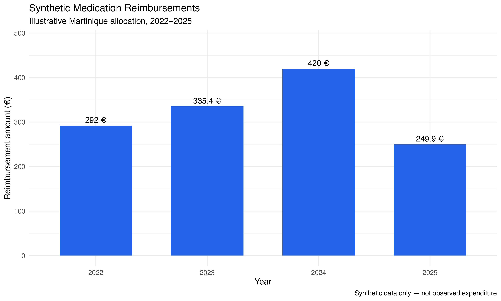

# Dengue Medico-Economic Analysis in Martinique

### Epidemiology | Health Economics | R Programming | Uncertainty Analysis

**Author:** Marie-Noëlle Nogeant  
**Background:** Master's Degree in Public Health – Quantitative and Econometric Methods for Health Research (MQERS), Aix-Marseille University  
**Year:** 2026

## Project Overview

This repository presents a reproducible, R-based demonstration of methods used in the medico-economic analysis of dengue epidemics.

It is inspired by analytical work conducted during my 2026 public health internship at Santé publique France, Antilles, focusing on the economic burden of the 2023–2024 dengue epidemic in Martinique.

The project illustrates how epidemiological indicators, healthcare expenditure data, laboratory testing costs, and probabilistic simulations can be integrated into a cost-of-illness framework.

**Important:** This public portfolio uses synthetic data and illustrative parameters. It does not reproduce confidential datasets, official surveillance results, or validated cost estimates.

## Research Objectives

The project aims to demonstrate methods for:

- Analyzing epidemiological trends and epidemic periods.
- Estimating excess healthcare utilization and associated costs.
- Processing large-scale healthcare reimbursement datasets.
- Examining pharmaceutical expenditure and laboratory testing costs.
- Integrating direct and indirect costs into a cost-of-illness framework.
- Quantifying uncertainty through Monte Carlo simulations.
- Producing reproducible statistical analyses and visualizations using R.

## Analytical Modules

The project is being developed around five complementary modules.

| Module | Analytical Focus | Status |
|---|---|---|
| 01. Epidemiological Analysis | Epidemic curves, reference periods, excess cases and healthcare utilization | Planned |
| 02. OpenDamir | Healthcare reimbursement data processing and cost estimation | Planned |
| 03. OpenMedic | Pharmaceutical reimbursement analysis and ATC classification | Initial synthetic demonstration available |
| 04. Laboratory Costs | Diagnostic testing activity and expenditure | Planned |
| 05. Monte Carlo Simulation | Probabilistic uncertainty and sensitivity analyses | Available — synthetic demonstration |

The planned modules will be adapted from previously developed analytical scripts, using synthetic data wherever necessary.

## Current Implementation: OpenMedic

The first available module demonstrates a simplified pharmaceutical expenditure analysis.

It includes:

- Reproducible generation of synthetic data.
- Classification of simulated observations by ATC5 code.
- Filtering and aggregation of reimbursement records.
- Calculation of annual reimbursement and dispensing totals.
- Application of an illustrative geographic allocation coefficient.
- Comparison with a reference year.
- Visualization of annual expenditure.

The allocation coefficient and simulated reimbursement amounts are demonstration inputs, not validated estimates of pharmaceutical expenditure in Martinique.

**R script:** [OpenMedic synthetic analysis](R/openmedic_analyse_synthetique.R)

### Example Output

*Illustrative results generated from synthetic data.*

## Tools and Methods

The analytical workflow draws on the following tools and methodological approaches:

**Programming and data processing**
- R and RStudio
- `data.table`, `dplyr` and `tidyr`
- Data cleaning, filtering, aggregation and transformation

**Statistical analysis**
- Descriptive epidemiology
- Reference-period comparisons
- Cost-of-illness methodology
- Probabilistic simulation
- Uncertainty and sensitivity analyses

**Reporting and visualization**
- `ggplot2`
- R Markdown and reproducible reporting
- Statistical tables and graphical outputs

Not all methods listed above have been implemented in the public repository yet.

## Reproducibility

The current OpenMedic demonstration uses a fixed random seed to generate synthetic observations.

To run the script in RStudio:

1. Clone or download this repository.
2. Open the project folder in RStudio.
3. Open `R/openmedic_analyse_synthetique.R`.
4. Run the script.

Required R packages are checked by the script.

**Current limitation:** The figure export uses a local file path. This will be replaced with a project-relative path to improve portability.

## Data Availability and Confidentiality

No restricted, individual-level, or confidential datasets from Santé publique France or its partners are included in this repository.

Publicly shared demonstrations use artificially generated data.

The original internship work and this public demonstration must therefore be distinguished. Synthetic results should not be interpreted as observed healthcare expenditures or official epidemiological estimates.

## Development Roadmap

The next development stages are:

- Refactor and document the existing analytical methods.
- Implement epidemiological analyses using simulated surveillance data.
- Build a reproducible healthcare expenditure analysis.
- Extend pharmaceutical and laboratory cost analyses.
- Integrate Monte Carlo simulations and sensitivity analyses.
- Improve code portability, validation and reporting.

## About the Author

I hold a Master's Degree in Public Health, specializing in quantitative and econometric methods for health research.

My academic background also includes mathematics, physics and chemistry, and two years of medical studies.

My interests include epidemiology, health economics, biostatistics, scientific programming, public health research, and clinical research.

**GitHub:** [MNNGT](https://github.com/MNNGT)
