::: {.callout-important}
## Avertissement concernant les données et la recherche

Ce rapport constitue une démonstration méthodologique indépendante, reposant intégralement sur des données synthétiques et des hypothèses économiques illustratives.

Il ne reproduit ni jeux de données de surveillance confidentiels, ni dossiers de patients réels, ni résultats institutionnels, ni estimations validées des coûts de la dengue en Martinique.

Les procédures analytiques synthétiques s'inspirent de méthodes développées au cours d'un stage de recherche en santé publique à Santé publique France, aux Antilles. Ce document ne constitue pas une publication officielle de cette institution.
:::

## Résumé {.unnumbered}

**Contexte :** Les épidémies de dengue représentent un enjeu important pour la surveillance en santé publique, la planification des ressources de soins et l'évaluation économique. La quantification de leurs répercussions potentielles nécessite de croiser des indicateurs épidémiologiques, des données de recours aux soins et des informations économiques.

**Objectif :** Présenter un cadre d'analyse reproductible permettant d'explorer les dimensions épidémiologiques et médico-économiques de la dengue à partir de jeux de données synthétiques.

**Méthodes :** Neuf scripts R, répartis en cinq modules analytiques, ont été développés pour illustrer la surveillance épidémiologique, le traitement des remboursements de soins, l'analyse des dépenses pharmaceutiques, l'étude de l'activité diagnostique des laboratoires et la modélisation probabiliste du coût de la maladie. Le cadre comprend des statistiques descriptives, des comparaisons de périodes épidémiologiques, une analyse du recours aux soins par âge, l'évaluation de la qualité des données et des simulations de Monte-Carlo.

**Résultats :** Dans le scénario synthétique correspondant à la période épidémique, les procédures ont produit 17 913 cas cliniquement évocateurs estimés, 2 184 passages aux urgences et 440 hospitalisations. Une simulation hypothétique distincte du coût de la maladie, fondée sur 10 000 itérations, a abouti à un coût total moyen de 7,700 millions d'euros et à un intervalle central de simulation à 95 % de 6,537 à 8,911 millions d'euros. Ces résultats indépendants ne constituent pas les composantes d'une estimation globale validée du fardeau de la maladie.

**Conclusion :** Cette étude de cas montre comment la programmation statistique, les méthodes épidémiologiques, le traitement des données de santé et l'analyse de l'incertitude peuvent contribuer à structurer une démarche de recherche médico-économique. Les résultats sont exclusivement des illustrations méthodologiques et ne peuvent être généralisés à la charge réelle de la dengue en Martinique.

**Mots-clés :** Dengue ; épidémiologie ; santé publique ; économie de la santé ; coût de la maladie ; simulation de Monte-Carlo ; recherche reproductible ; R ; données synthétiques.

---

## Introduction

La dengue est une infection virale transmise par les moustiques, qui constitue un enjeu majeur de santé publique dans les régions tropicales et subtropicales (Organisation mondiale de la Santé, 2025).

La surveillance épidémiologique est essentielle pour décrire les variations temporelles de l'activité de la maladie, identifier les périodes de transmission accrue et suivre la pression exercée sur les services de santé.

Au-delà des indicateurs épidémiologiques, les épidémies de dengue soulèvent des questions importantes concernant le recours aux soins, les examens diagnostiques, les dépenses pharmaceutiques, les hospitalisations et les pertes de productivité.

Une approche médico-économique vise à examiner ces dimensions complémentaires dans un cadre analytique structuré.

Toutefois, l'interprétation des données de soins et des données épidémiologiques nécessite une attention particulière à la qualité des données, à la définition des indicateurs, aux différences entre les périodes d'observation et à l'incertitude entourant les hypothèses économiques.

La présente étude de cas reprend des méthodes analytiques développées au cours d'une formation à la recherche en santé publique et les applique à des jeux de données entièrement synthétiques.

Elle ne cherche pas à produire des estimations empiriques du fardeau de la dengue, mais à montrer comment organiser, mettre en œuvre, valider et communiquer scientifiquement des analyses épidémiologiques et économiques reproductibles.

### Objectifs de la recherche

Cette étude de cas méthodologique poursuit six objectifs :

1. Décrire des profils de surveillance de la dengue simulés sur plusieurs périodes épidémiologiques sélectionnées.
2. Comparer des indicateurs descriptifs de recours aux soins associé à la dengue.
3. Illustrer le traitement de jeux de données synthétiques relatifs aux remboursements de soins et de médicaments.
4. Explorer l'activité des laboratoires de diagnostic et des composantes économiques illustratives.
5. Quantifier l'incertitude de scénarios fictifs de coût de la maladie au moyen de simulations de Monte-Carlo.
6. Présenter les méthodes et les résultats dans un format de rapport scientifique reproductible.

---

## Matériel et méthodes

### Plan de l'étude

Ce projet a été conçu comme une étude de cas méthodologique reproductible, utilisant exclusivement des jeux de données épidémiologiques et économiques synthétiques.

Le cadre analytique a été développé pour illustrer les principales étapes d'une démarche de recherche médico-économique : génération et prétraitement des données, analyse épidémiologique descriptive, évaluation des dépenses de santé, modélisation probabiliste et rédaction scientifique.

L'étude ne porte sur aucun patient réel et n'utilise aucune observation originale issue d'une surveillance institutionnelle. Tous les résultats numériques rendus publics proviennent de jeux de données simulés ou d'hypothèses illustratives.

Le cadre analytique comprend cinq modules complémentaires mis en œuvre à l'aide de neuf scripts R :

1. Surveillance épidémiologique et analyse du recours aux soins.
2. Analyse des remboursements de soins à l'aide d'une procédure OpenDamir synthétique.
3. Analyse des dépenses pharmaceutiques à partir d'enregistrements synthétiques de type OpenMedic.
4. Analyse de l'activité diagnostique des laboratoires et des coûts associés.
5. Modélisation probabiliste du coût de la maladie par simulation de Monte-Carlo.

Ces modules sont des démonstrations méthodologiques indépendantes, et non les composantes d'un modèle unique d'estimation économique validé.

### Sources et génération des données synthétiques

Des jeux de données synthétiques ont été générés sous R afin de reproduire certaines caractéristiques structurelles de la surveillance épidémiologique, des remboursements de soins, de l'activité des laboratoires et des données économiques.

Les procédures de génération ont été conçues pour créer des structures analytiques plausibles sans reproduire des observations épidémiologiques réelles ni des jeux de données de recherche confidentiels.

Les jeux de données simulés comprennent :

- Des indicateurs épidémiologiques hebdomadaires de dengue et de certaines infections respiratoires.
- Des passages aux urgences et des hospitalisations.
- Des données synthétiques de recours aux soins selon l'âge.
- Des enregistrements mensuels de remboursements de soins.
- Des enregistrements de délivrance et de remboursement de médicaments.
- Des volumes d'analyses de laboratoire et des informations financières illustratives.
- Des paramètres économiques d'entrée destinés aux simulations probabilistes.

Des graines aléatoires fixées ont été utilisées dans les procédures analytiques pour favoriser leur reproductibilité.

Les jeux de données intermédiaires sont générés localement et exclus du dépôt Git public. Celui-ci contient plutôt les scripts sources, des synthèses analytiques, des résultats de contrôle qualité et des visualisations.

### Analyse de la surveillance épidémiologique

#### Indicateurs de surveillance

L'analyse épidémiologique distingue plusieurs indicateurs de surveillance.

L'indicateur principal de dengue est le nombre estimé de cas cliniquement évocateurs (CCE), obtenu à partir d'une série simulée et extrapolée de surveillance sentinelle.

Les autres indicateurs synthétiques comprennent :

- Les nombres bruts de consultations sentinelles.
- Les cas de dengue biologiquement confirmés.
- Les cas probables de dengue.
- Les passages aux urgences associés à la dengue.
- Les hospitalisations associées à la dengue.

Les cas confirmés et probables ont été distingués des CCE estimés, ces indicateurs correspondant à des concepts de surveillance et à des processus d'identification différents.

L'analyse comprend également des indicateurs fictifs de grippe, de COVID-19 et de bronchiolite, destinés à des visualisations comparatives.

#### Définition des périodes d'étude

Trois périodes d'étude illustratives ont été définies à partir des semaines calendaires ISO.

| Période d'étude | Fenêtre temporelle | Durée |
|---|---|---:|
| P1 — Période de référence | S30/2022–S24/2023 | 47 semaines |
| P2 — Scénario épidémique | S30/2023–S24/2024 | 47 semaines |
| P3 — Période de référence supplémentaire | S18/2025–S48/2025 | 31 semaines |

P1 et P2 ont une durée identique, ce qui permet une comparaison descriptive directe des indicateurs simulés cumulés.

P3 comporte moins de semaines d'observation. Des moyennes hebdomadaires ont donc également été calculées pour comparer P3 aux autres périodes.

Une procédure complémentaire de surveillance comparative évalue par ailleurs des fenêtres d'étude strictes alternatives de 36 semaines pour P1 et P2, tout en conservant la période de comparaison P3 de 31 semaines.

Ces périodes correspondent à des fenêtres analytiques illustratives et ne définissent pas les limites réelles d'une épidémie.

#### Analyse épidémiologique descriptive

Les indicateurs hebdomadaires de surveillance ont été agrégés par période d'étude.

Pour chaque période, les analyses ont calculé :

- Le nombre total estimé de cas cliniquement évocateurs.
- Le nombre total de cas confirmés et probables.
- Le nombre de passages aux urgences.
- Le nombre d'hospitalisations.
- L'activité hebdomadaire moyenne.
- Les différences absolues entre les périodes.
- Les différences entre les moyennes hebdomadaires.

La comparaison descriptive principale était définie par :

$$
\Delta_{P2-P1} = Y_{P2} - Y_{P1}
$$

où $Y$ représente la valeur cumulée d'un indicateur épidémiologique synthétique sélectionné.

Afin de tenir compte, de manière descriptive, des différences de durée entre les périodes, les écarts entre les moyennes hebdomadaires ont été calculés comme suit :

$$
\Delta_{\mathrm{weekly}} =
\frac{Y_{P2}}{n_{P2}} -
\frac{Y_{P1}}{n_{P1}}
$$

où $n$ désigne le nombre de semaines observées au cours de chaque période.

Ces calculs décrivent des différences entre séries synthétiques ; ils ne constituent pas des estimations causales d'un excès de cas attribuable à la maladie.

### Dynamique comparative des maladies infectieuses

Les évolutions temporelles de la dengue, de la grippe, de la COVID-19 et de la bronchiolite ont été comparées.

Une moyenne mobile centrée sur trois semaines a été appliquée pour lisser les variations à court terme des séries hebdomadaires simulées.

Pour les comparaisons graphiques, chaque indicateur lissé a été transformé indépendamment par une normalisation min–max :

$$
Z_t = \frac{X_t - X_{\min}}{X_{\max} - X_{\min}}
$$

où $X_t$ représente une observation hebdomadaire lissée, et $X_{\min}$ et $X_{\max}$ sont les valeurs minimale et maximale de la série correspondante.

Cette transformation permet de comparer des profils temporels relatifs plutôt que des nombres absolus de cas.

Deux indicateurs alternatifs de dengue ont été représentés séparément :

1. Le nombre estimé de cas cliniquement évocateurs de dengue.
2. L'ensemble des cas de dengue biologiquement confirmés et probables.

L'analyse évite ainsi d'interpréter des valeurs normalisées comme des mesures équivalentes de l'incidence des maladies. La reconstruction synthétique de la visualisation comparative multimaladies demandée pendant le stage est présentée dans la @fig-spf-superposition.

### Recours aux soins et analyse par classe d'âge

Le recours aux soins simulé a été étudié à partir des passages aux urgences et des hospitalisations.

Cinq classes d'âge ont été considérées :

- Moins de 5 ans.
- De 5 à 14 ans.
- De 15 à 44 ans.
- De 45 à 64 ans.
- 65 ans et plus.

Les recours aux soins hebdomadaires simulés ont été répartis entre ces groupes par tirage multinomial, selon des probabilités fictives prédéfinies et des graines aléatoires fixées.

Ces procédures de répartition ont conservé le nombre total de recours simulés pour chaque semaine.

Les effectifs et les proportions par classe d'âge ont ensuite été calculés pour chaque période d'étude.

Des contrôles de cohérence ont vérifié que la somme des recours par âge correspondait au nombre total de passages aux urgences ou d'hospitalisations.

Ces recours ne correspondent pas nécessairement à des patients distincts, et les distributions par âge ne reflètent pas les caractéristiques démographiques observées des patients atteints de dengue en Martinique.

#### Indicateurs descriptifs d'hospitalisation

Trois ratios agrégés d'hospitalisation ont été calculés avec des dénominateurs différents :

$$
R_{CCE} =
\frac{\text{Hospitalisations}}{\text{CCE estimés}}
\times 100
$$

$$
R_{\mathrm{confirmed}} =
\frac{\text{Hospitalisations}}{\text{Cas confirmés}}
\times 100
$$

$$
R_{\mathrm{emergency}} =
\frac{\text{Hospitalisations}}{\text{Passages aux urgences}}
\times 100
$$

Ces ratios ont été conservés en tant qu'indicateurs descriptifs, car leurs numérateurs et dénominateurs peuvent ne pas correspondre à des observations appariées pour les mêmes individus.

Ils ne doivent donc pas être interprétés comme des probabilités individuelles ni comme des risques cliniques d'hospitalisation.

### Analyse des remboursements de soins : OpenDamir

Une procédure synthétique de traitement des remboursements de soins a été développée pour illustrer l'exploitation de grandes bases de données administratives.

Elle a généré 25 fichiers mensuels de remboursement et appliqué une suite standardisée d'opérations de traitement :

- Importation sélective de variables.
- Filtres géographiques et relatifs aux soins ambulatoires.
- Classification des codes de prestations de santé.
- Repérage des montants de remboursement négatifs.
- Suivi des exclusions et de la qualité des données.
- Alignement temporel des dates de soins et de remboursement.
- Agrégation des dépenses sur les périodes sélectionnées.

Dix-neuf codes de prestations de santé ont été répartis en quatre catégories analytiques.

Trois approches complémentaires d'agrégation des remboursements ont été comparées :

**Approche en flux complet :** inclusion des remboursements éligibles enregistrés dans les extractions mensuelles sélectionnées.

**Approche stricte par période de soins :** restriction aux soins réalisés pendant la période analytique correspondante.

**Approche cumulative :** inclusion des soins éligibles de la période courante et de certaines périodes antérieures, afin de tenir compte des délais de remboursement simulés.

Des coefficients illustratifs de pondération territoriale ont également été appliqués pour montrer l'influence potentielle des hypothèses d'allocation géographique.

Les catégories de remboursement retenues ne permettent pas, à elles seules, d'établir si les dépenses de soins étaient attribuables à la dengue.

### Analyse des dépenses pharmaceutiques : OpenMedic

Une procédure complémentaire d'analyse des remboursements pharmaceutiques a été mise en œuvre à partir d'enregistrements synthétiques de délivrance et de remboursement de médicaments.

L'analyse comprenait :

- La génération d'observations pharmaceutiques synthétiques.
- La classification des enregistrements à l'aide des codes anatomiques, thérapeutiques et chimiques (ATC).
- Le filtrage et l'agrégation des informations de remboursement pharmaceutique.
- Le calcul des dépenses pharmaceutiques annuelles.
- La comparaison d'années d'étude sélectionnées.
- L'application de coefficients illustratifs d'allocation géographique.

Des tableaux annuels de synthèse et des graphiques ont été produits pour illustrer la présentation reproductible des dépenses pharmaceutiques.

Les montants de remboursement synthétiques n'ont pas été interprétés comme des coûts pharmaceutiques réellement observés et liés à la dengue.

### Activité de diagnostic en laboratoire et analyse économique

Deux procédures complémentaires d'analyse des laboratoires ont été développées.

#### Activité de diagnostic et recettes des laboratoires

La première analyse a étudié une activité diagnostique simulée, couvrant certaines périodes entre 2022 et 2025.

Les catégories diagnostiques comprenaient :

- Les tests PCR de la dengue.
- Les tests antigéniques NS1.
- Les sérologies de la dengue, notamment IgG et IgM.

Les volumes mensuels de tests ont été agrégés par catégorie diagnostique et période d'étude.

Des recettes théoriques illustratives ont été calculées à partir de l'activité diagnostique simulée et d'hypothèses tarifaires.

Des contrôles de cohérence ont comparé les valeurs financières simulées aux calculs théoriques.

Les comparaisons entre périodes ont notamment utilisé les volumes moyens mensuels de tests, afin de tenir compte des différences de durée d'observation.

Les recettes des laboratoires ont été considérées comme une mesure financière distincte, sans être assimilées aux remboursements de l'Assurance maladie ni aux coûts totaux des soins.

#### Analyses réalisées localement et sous-traitées

La seconde procédure a examiné l'organisation d'une activité de diagnostic synthétique entre des services locaux et des prestataires extérieurs.

Les données simulées couvraient 42 mois et distinguaient plusieurs catégories de tests, dont les PCR sanguines, les PCR sur liquide cérébrospinal, les tests antigéniques NS1 et les sérologies IgG.

L'analyse portait sur :

- L'activité diagnostique mensuelle.
- Les différences entre les prestations locales et sous-traitées.
- Les comparaisons entre périodes d'étude.
- L'exhaustivité des données.
- L'identification d'observations indisponibles.
- Des interruptions opérationnelles illustratives.

Les observations indisponibles ont été conservées comme valeurs manquantes, sans être systématiquement remplacées par zéro.

Cette distinction visait à montrer l'importance de ne pas confondre l'absence d'information avec une véritable absence d'activité diagnostique.

Tous les scénarios opérationnels étaient fictifs.

### Analyse probabiliste du coût de la maladie

Une simulation probabiliste du coût de la maladie a été développée pour illustrer la propagation de l'incertitude dans un cadre d'évaluation économique.

La modélisation distinguait deux grandes composantes économiques :

**Coûts directs :** dépenses de santé illustratives associées aux soins ambulatoires, aux hospitalisations, aux services d'urgence, aux médicaments et aux examens diagnostiques.

**Coûts indirects :** pertes de productivité illustratives associées aux arrêts de travail et aux hypothèses correspondantes.

Le modèle associait des lois de probabilité à certains paramètres d'entrée incertains, notamment :

- Des lois normales pour certaines dépenses de santé et certains paramètres épidémiologiques.
- Des lois triangulaires pour les durées d'hospitalisation et d'arrêt de travail.
- Des lois uniformes pour certaines hypothèses de dépenses pharmaceutiques non remboursées.

Au total, **10 000 itérations de Monte-Carlo** ont été réalisées.

Pour chaque itération, le coût économique total a été calculé à partir des composantes directes et indirectes modélisées.

La distribution simulée des coûts a été résumée au moyen de statistiques descriptives et d'un intervalle central de simulation à 95 %.

Des analyses de sensibilité complémentaires ont examiné l'influence de certaines hypothèses, notamment le niveau des salaires et la durée des arrêts de travail.

Cette simulation du coût de la maladie constitue un scénario hypothétique indépendant : elle ne correspond pas à une estimation intégrée obtenue par addition des résultats des autres modules analytiques.

### Qualité des données et reproductibilité

Des procédures de traitement et de validation des données ont été intégrées à l'ensemble des analyses.

Selon les modules, elles comprenaient :

- La vérification des dimensions attendues des jeux de données.
- Le repérage des observations manquantes ou invalides.
- La validation des variables temporelles et des définitions des semaines ISO.
- La vérification de la durée des périodes d'étude.
- La comparaison des totaux agrégés et stratifiés.
- L'examen des exclusions effectuées lors du traitement des remboursements.
- La comparaison des valeurs financières théoriques et simulées des laboratoires.
- La génération automatisée de tableaux de synthèse et de visualisations.

Les analyses ont été réalisées sous R, notamment avec les packages `dplyr`, `tidyr`, `data.table`, `ggplot2` et `patchwork`.

Les scripts sources, certains résultats et la documentation technique sont disponibles dans le dépôt du projet.

La production du rapport s'appuie sur Quarto pour générer un document de recherche HTML structuré.

Certains scripts analytiques nécessitent encore l'adaptation de chemins locaux et une documentation plus complète des dépendances avant que l'ensemble du dépôt puisse être considéré comme portable entre environnements informatiques.

### Interprétation statistique

Tous les résultats ont été interprétés de manière descriptive dans le cadre des scénarios synthétiques.

Aucune inférence statistique sur la population martiniquaise n'a été réalisée, et aucune interprétation causale n'a été attribuée aux différences entre les périodes d'étude illustratives.

Ces analyses visent à illustrer la méthodologie de recherche, la transparence du traitement des données, les procédures de validation, la quantification de l'incertitude et une communication scientifique reproductible.

---

## Résultats

Tous les résultats présentés dans cette section proviennent de jeux de données synthétiques et d'hypothèses analytiques illustratives. Ils montrent l'application des méthodes proposées et ne représentent pas des résultats épidémiologiques ou économiques observés en Martinique.

### Surveillance épidémiologique et nombres de cas

#### Évolution temporelle de l'activité simulée de la dengue

Le jeu de données épidémiologiques comprenait 417 observations hebdomadaires couvrant la période 2018–2025.

La série de surveillance simulée a permis d'illustrer les variations temporelles de l'activité de la dengue et de comparer trois périodes analytiques prédéfinies.

La @fig-dengue-timeline présente l'évolution hebdomadaire des cas cliniquement évocateurs (CCE) estimés de dengue, en mettant en évidence les périodes d'étude correspondantes.

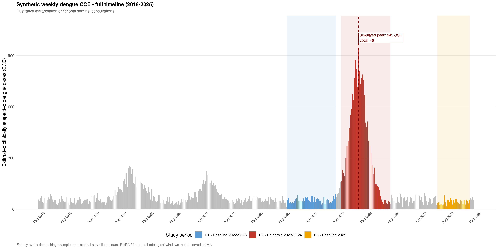{#fig-dengue-timeline fig-alt="Série de surveillance hebdomadaire synthétique de la dengue, avec mise en évidence des périodes d'étude"}

Dans le scénario épidémique synthétique (P2), la valeur hebdomadaire maximale atteignait **945 CCE estimés au cours de la semaine ISO 46 de 2023**.

Ce pic découle des hypothèses utilisées pour simuler la courbe épidémique et ne doit pas être interprété comme un résultat observé de la surveillance de la dengue.

#### Comparaison des périodes épidémiologiques

Trois périodes analytiques ont été étudiées :

| Période | Description | Durée |
|---|---|---:|
| P1 | Scénario de référence, 2022–2023 | 47 semaines |
| P2 | Scénario épidémique, 2023–2024 | 47 semaines |
| P3 | Scénario de référence supplémentaire, 2025 | 31 semaines |

L'agrégation des données de surveillance synthétiques a produit **17 913 CCE estimés pendant P2**.

La comparaison entre P2 et P1, à durée hebdomadaire identique, a abouti à un écart net de **15 371 CCE estimés** dans le scénario simulé.

Ces résultats illustrent le calcul de différences entre une période épidémique fictive et une période de référence.

Toutefois, la comparaison est descriptive et ne fournit aucune estimation causale ou statistiquement ajustée d'un excès de cas attribuable à la dengue.

De plus, P3 comprend seulement 31 semaines, contre 47 semaines pour P1 et P2. Les comparaisons faisant intervenir P3 doivent donc tenir compte des durées d'observation différentes.

La @fig-period-counts illustre la répartition des nombres de cas simulés et des indicateurs de recours aux soins entre les périodes d'étude.

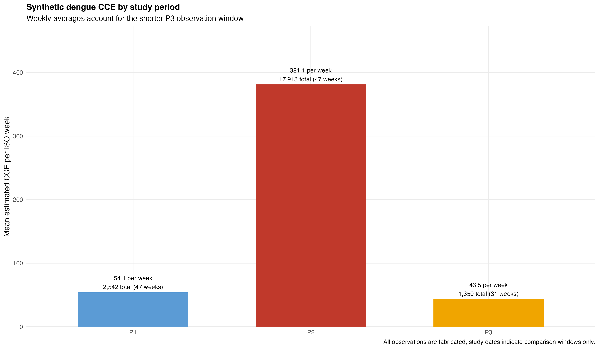{#fig-period-counts fig-alt="Nombres de cas synthétiques de dengue et de recours aux soins au cours de trois périodes d'étude"}

#### Recours aux soins pendant la période épidémique synthétique

L'analyse a également porté sur les recours aux soins simulés associés à l'activité de la dengue.

Pendant P2, le jeu de données comprenait :

| Indicateur de recours aux soins | Total synthétique P2 |
|---|---:|
| Passages aux urgences | 2 184 |
| Hospitalisations | 440 |

Ces valeurs illustrent l'agrégation des indicateurs de recours aux soins dans le scénario de période épidémique.

Les passages aux urgences et les hospitalisations correspondent à des recours aux soins, et non nécessairement à des personnes différentes.

Par conséquent, leurs totaux ne doivent pas être additionnés pour estimer le nombre de patients ayant nécessité une prise en charge médicale.

#### Recours aux soins par classe d'âge

Les recours aux soins ont ensuite été répartis entre cinq classes d'âge à l'aide de probabilités d'allocation synthétiques.

Les catégories d'âge étaient : moins de 5 ans, 5–14 ans, 15–44 ans, 45–64 ans et 65 ans ou plus.

La @fig-age-distribution présente la distribution simulée par âge des passages aux urgences et des hospitalisations.

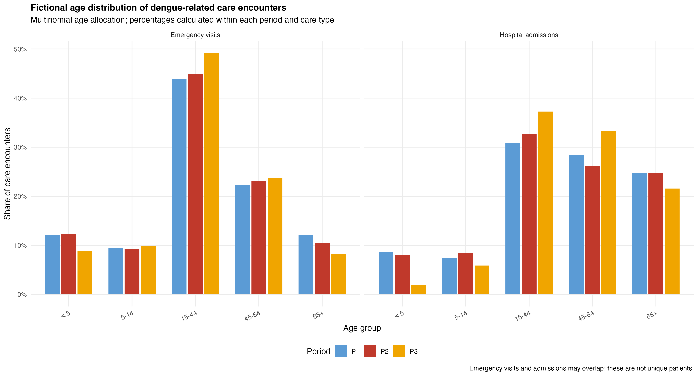{#fig-age-distribution fig-alt="Comparaison des recours aux soins synthétiques par classe d'âge et période d'étude"}

La procédure de stratification par âge a conservé le nombre total de recours aux soins simulés.

Cela a été vérifié par des contrôles automatisés de concordance entre la somme des effectifs par âge et les totaux agrégés correspondants.

Les distributions obtenues illustrent la mise en œuvre d'une analyse descriptive stratifiée, mais ne reflètent pas la répartition réelle par âge du recours aux soins lié à la dengue en Martinique.

#### Comparaisons complémentaires de surveillance

Une procédure complémentaire a analysé **208 observations hebdomadaires synthétiques couvrant 2022–2025** afin d'illustrer la comparaison graphique de la dengue, de la grippe, de la COVID-19 et de la bronchiolite.

La dengue était représentée par deux mesures distinctes de surveillance : les CCE extrapolés simulés et l'ensemble simulé des cas biologiquement confirmés et probables. Des visualisations distinctes ont été utilisées pour éviter de considérer ces indicateurs comme interchangeables.

L'analyse a comparé une **définition à fenêtre longue** (47 semaines pour P1 et P2) à une **définition à fenêtre stricte** (36 semaines pour P1 et P2) ; P3 est restée une période de 31 semaines dans les deux cas. Une moyenne mobile centrée sur trois semaines et une normalisation min–max propre à chaque indicateur ont facilité la comparaison de la chronologie relative et de la forme des courbes de maladies fictives.

#### Courbes épidémiques comparatives — Visualisation demandée (reconstruction synthétique)

Une visualisation comparative de **la dengue, la grippe, la COVID-19 et la bronchiolite** avait été demandée pendant le stage de recherche en santé publique. La @fig-spf-superposition reproduit la structure méthodologique de ce livrable à partir **d'observations entièrement synthétiques** ; il ne s'agit pas de la figure institutionnelle originale et elle ne reproduit pas les données de surveillance de Santé publique France.

Le panneau supérieur compare les CCE de dengue extrapolés aux trois indicateurs de maladies respiratoires. Le panneau inférieur utilise à la place les cas de dengue biologiquement confirmés et probables. Dans chaque panneau, les quatre séries sont représentées sur un axe temporel commun ; une moyenne mobile centrée sur trois semaines et une normalisation min–max indépendante mettent en évidence leurs profils temporels relatifs. Le **scénario épidémique illustratif de dengue 2023–2024 (P2)** est mis en évidence parmi les périodes d'étude ombrées.

{#fig-spf-superposition fig-alt="Deux graphiques de surveillance comparative synthétique entre 2022 et 2025. Panneau supérieur : CCE estimés de dengue, grippe, COVID-19 et bronchiolite. Panneau inférieur : cas de dengue biologiquement confirmés et probables, avec les mêmes infections respiratoires. Les périodes illustratives P1, P2 et P3 sont ombrées."}

Les visualisations obtenues sont descriptives. Les indicateurs ayant des significations différentes et les fenêtres d'observation étant de durées variables, leurs hauteurs normalisées et leurs totaux cumulés ne doivent pas être interprétés comme des mesures d'incidence directement comparables ou comme la charge observée des maladies.

#### Ratios descriptifs complémentaires

La procédure d'analyse des nombres de cas a également produit des ratios agrégés comparant les hospitalisations simulées aux CCE estimés, aux cas biologiquement confirmés et aux passages aux urgences. Ces ratios utilisent des dénominateurs différents et ne permettent pas de suivre les individus entre la surveillance et les lieux de soins. Ils illustrent donc l'importance des définitions des numérateurs et dénominateurs, plutôt que d'estimer une probabilité individuelle d'hospitalisation.

### Analyse des remboursements de soins : OpenDamir

#### Traitement des données et contrôle qualité

La procédure OpenDamir synthétique a illustré le traitement d'enregistrements administratifs de remboursements de soins au moyen d'une chaîne de traitement reproductible sous R.

**Vingt-cinq jeux de données mensuels synthétiques** ont été générés, totalisant **37 500 enregistrements initiaux**. Après application des filtres géographiques, administratifs et relatifs aux prestations, **19 491 enregistrements** ont été conservés.

La procédure comprenait l'importation sélective, la classification des codes de prestations de santé, le repérage des remboursements négatifs, les contrôles d'exhaustivité et la traçabilité des décisions de filtrage. **Dix-neuf codes de prestations** ont été regroupés en **quatre catégories analytiques**.

L'écart important entre les nombres initiaux et conservés illustre l'effet des définitions de la population analytique éligible sur les synthèses de données administratives. Le nombre conservé traduit une logique de filtrage synthétique, et non une estimation des recours aux soins éligibles ou attribuables à la dengue.

#### Comparaison des méthodes d'agrégation des remboursements

Trois approches ont été comparées dans les enregistrements simulés de remboursement :

1. **Approche en flux complet :** remboursements éligibles enregistrés dans les extractions mensuelles sélectionnées.
2. **Approche stricte par période de soins :** remboursements éligibles correspondant à des soins réalisés pendant la fenêtre analytique prédéfinie.
3. **Approche cumulative :** soins éligibles de la période courante et de certaines périodes précédentes, illustrant l'effet des dates de remboursement.

Dans le scénario synthétique de période épidémique P2, l'approche cumulative dépassait l'approche stricte par période de soins de **4 918,12 €**. L'écart illustratif correspondant pour la période comparative de 2025 était de **1 692,38 €**.

Ces écarts montrent comment la définition des fenêtres temporelles et les délais administratifs de remboursement peuvent modifier les synthèses de dépenses, sans qu'ils traduisent une quelconque modification du fardeau clinique réel de la maladie.

La @fig-opendamir-methods compare les résultats obtenus avec les différentes approches d'agrégation temporelle.

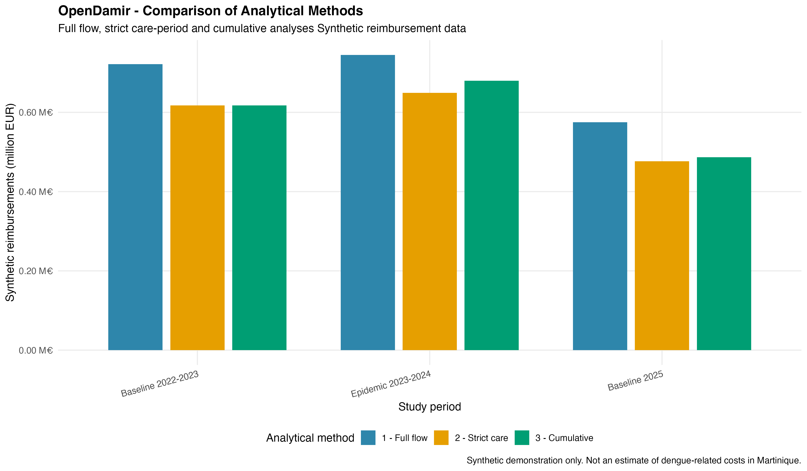{#fig-opendamir-methods fig-alt="Comparaison des méthodes synthétiques d'agrégation des remboursements OpenDamir"}

#### Pondération territoriale et interprétation

Des coefficients illustratifs de pondération géographique ont été appliqués pour montrer comment les hypothèses d'allocation territoriale peuvent influer sur les montants agrégés de remboursement.

La @fig-opendamir-weighting présente les comparaisons simulées correspondantes.

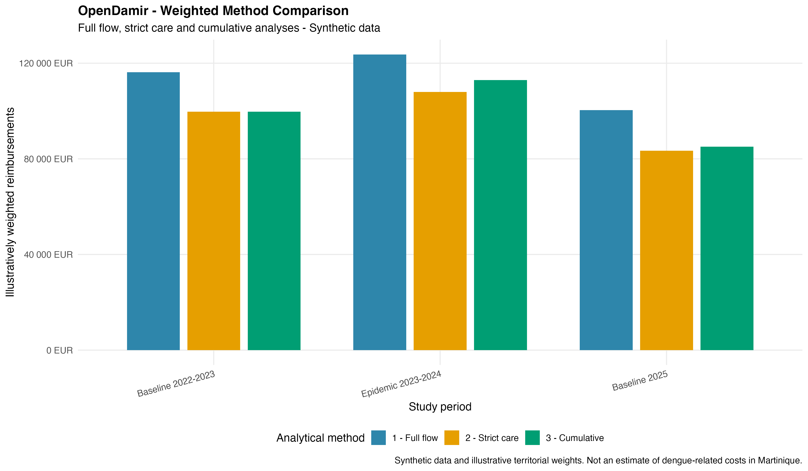{#fig-opendamir-weighting fig-alt="Estimations synthétiques des remboursements OpenDamir avec pondération territoriale"}

Le choix de la méthode et les hypothèses géographiques influent tous deux sur les montants synthétiques présentés. Ces indicateurs de dépenses administratives ne permettent pas, à eux seuls, d'établir que les prestations de soins sélectionnées ont été causées par la dengue. Le module OpenDamir illustre donc une analyse reproductible des remboursements, et non une estimation empirique des coûts de la dengue.

### Analyse des dépenses pharmaceutiques : OpenMedic

#### Données synthétiques de remboursement pharmaceutique

Le module OpenMedic mettait en œuvre une procédure reproductible de génération et d'analyse d'enregistrements synthétiques de délivrance et de remboursement de médicaments. Il utilisait la classification **anatomique, thérapeutique et chimique (ATC)**, le filtrage des enregistrements, l'agrégation annuelle et des hypothèses illustratives d'allocation géographique.

Cette démarche reproduit les grandes tâches analytiques susceptibles de se présenter avec des bases administratives de données pharmaceutiques, sans utiliser d'enregistrement OpenMedic original dans la simulation publique.

#### Dépenses pharmaceutiques annuelles

Les montants synthétiques de remboursement ont été agrégés par année pour produire des synthèses descriptives des dépenses et comparer les évolutions annuelles simulées.

La @fig-openmedic-expenditure présente les montants annuels de remboursement produits par la procédure pharmaceutique.

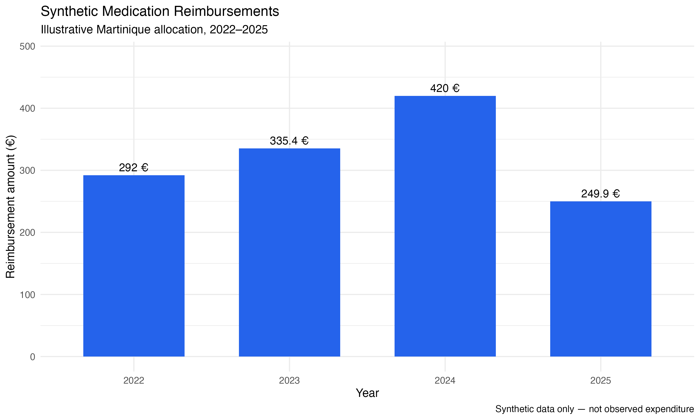{#fig-openmedic-expenditure fig-alt="Dépenses annuelles synthétiques de remboursement pharmaceutique"}

Les variations représentées reflètent les hypothèses utilisées pour générer les observations fictives. Ce graphique ne permet aucune affirmation chiffrée concernant les dépenses médicamenteuses réellement observées en Martinique.

#### Interprétation méthodologique et limites

Les enregistrements de remboursements pharmaceutiques peuvent décrire les délivrances et les dépenses, mais ne permettent pas nécessairement d'identifier l'indication thérapeutique. Une variation des dépenses pharmaceutiques annuelles ne peut donc pas être attribuée à la dengue sans données supplémentaires reliant les dépenses à la maladie, sans définition des critères d'éligibilité et sans ajustements appropriés.

Les hypothèses d'allocation régionale utilisées ici ne constituent pas des estimations validées des coûts territoriaux. L'analyse OpenMedic reste un exemple indépendant de traitement des données, et non une estimation des coûts médicamenteux attribuables à la dengue.

### Activité diagnostique des laboratoires et analyse économique

#### Volumes d'examens diagnostiques et recettes simulées

La première procédure appliquée aux laboratoires reproduisait la structure d'une analyse de l'activité diagnostique et des recettes à l'aide d'enregistrements entièrement simulés. Elle comprenait **93 enregistrements mensuels par catégorie de test** et **11 353 examens synthétiques**, répartis entre des catégories diagnostiques telles que la PCR dengue, les tests antigéniques NS1 et les sérologies.

La comparaison principale distinguait des scénarios illustratifs de référence et de période épidémique. L'activité mensuelle moyenne a été utilisée afin de discuter les périodes de durées différentes sur une base descriptive comparable.

| Période d'étude synthétique | Nombre moyen de tests par mois | Recettes moyennes du laboratoire par mois |
|---|---:|---:|
| Référence 2022–2023 | 206 | 5 434 € |
| Scénario épidémique 2023–2024 | 618 | 16 282 € |
| Référence 2025 | 210 | 5 583 € |

Le scénario épidémique simulé a produit environ **trois fois** plus d'examens diagnostiques mensuels que le premier scénario de référence. Il s'agit d'une propriété programmée du jeu de données fictif, et non d'une mesure de la demande d'examens diagnostiques en Martinique.

Sur l'ensemble de la démonstration synthétique consacrée aux laboratoires, les recettes illustratives s'élevaient à environ **299 678 €**.

La @fig-laboratory-volumes présente la répartition temporelle synthétique de l'activité diagnostique.

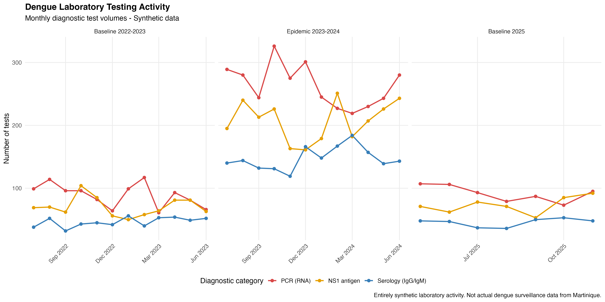{#fig-laboratory-volumes fig-alt="Volumes mensuels synthétiques d'analyses diagnostiques en laboratoire"}

La @fig-laboratory-revenue présente les recettes simulées correspondantes.

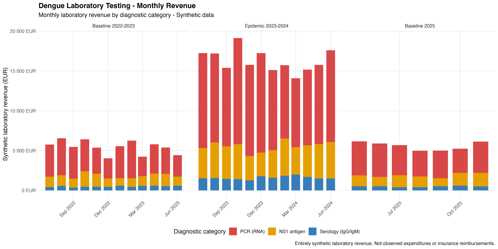{#fig-laboratory-revenue fig-alt="Recettes théoriques mensuelles associées à une activité diagnostique synthétique"}

Les recettes sont ici calculées à partir d'une activité fictive et d'hypothèses tarifaires. Elles ne doivent pas être confondues avec le bénéfice réellement réalisé par un laboratoire, les remboursements de l'Assurance maladie ou le coût sociétal total de la dengue.

#### Analyses locales, sous-traitance et données manquantes

La seconde procédure a étudié un parcours diagnostique fictif distinguant les analyses réalisées localement et celles confiées à un prestataire extérieur. Elle portait sur **42 mois, de juin 2022 à novembre 2025**, avec **336 enregistrements mensuels au niveau des sources**, quatre catégories d'examens diagnostiques et deux sources de laboratoire.

Les catégories diagnostiques étaient les PCR sanguines, les PCR sur liquide cérébrospinal, les tests antigéniques NS1 et les sérologies IgG. La simulation distinguait les examens attribués à un laboratoire local et ceux transmis à un prestataire extérieur.

Plusieurs enregistrements de PCR de **septembre à décembre 2022** étaient volontairement indisponibles. Ils ont été conservés comme valeurs manquantes, plutôt que remplacés par zéro, afin de ne pas laisser entendre qu'aucun examen n'avait été réalisé. La procédure introduisait également une **interruption de sous-traitance entièrement fictive en novembre 2023**, utilisée comme cas-test pour l'analyse des données opérationnelles.

La @fig-laboratory-organization rassemble les évolutions mensuelles et les comparaisons entre l'activité diagnostique synthétique locale et sous-traitée.

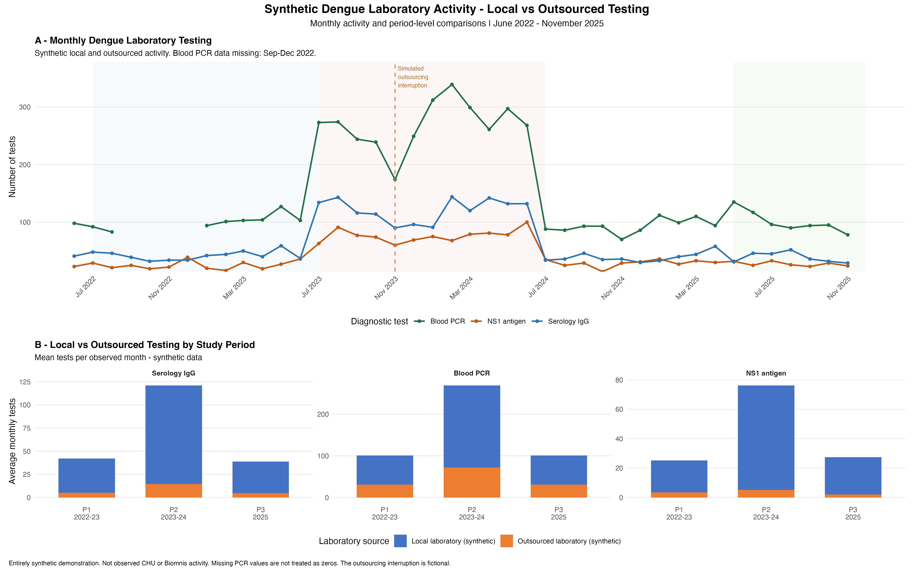{#fig-laboratory-organization fig-alt="Activité de laboratoire synthétique par mois, catégorie diagnostique et source locale ou sous-traitée"}

Ni l'interruption simulée ni les différences visibles sur le graphique ne documentent un événement opérationnel réel au CHU de Martinique, chez Biomnis ou dans un autre laboratoire. Les deux procédures relatives aux laboratoires sont des exercices méthodologiques distincts, dont les résultats ne sont pas regroupés pour estimer les coûts de la maladie.

### Analyse probabiliste du coût de la maladie : simulation de Monte-Carlo

#### Distribution des coûts économiques hypothétiques

Le dernier module a réalisé **10 000 itérations de Monte-Carlo** pour illustrer la propagation de l'incertitude dans un modèle hypothétique de coût de la maladie.

La simulation distinguait les coûts directs des soins et les pertes indirectes de productivité. Des lois de probabilité illustratives ont été attribuées aux paramètres d'entrée incertains, puis un coût total a été calculé pour chaque tirage.

Le scénario synthétique de référence a produit les résultats suivants :

| Indicateur | Résultat de la simulation synthétique |
|---|---:|
| Nombre d'itérations | 10 000 |
| Coût total moyen | 7,700 millions d'euros |
| Coût total médian | 7,693 millions d'euros |
| Intervalle central de simulation à 95 % | 6,537–8,911 millions d'euros |
| Part des coûts directs | 84,9 % |
| Part des coûts indirects | 15,1 % |

L'intervalle de simulation décrit les 95 % centraux de la **distribution fictive des coûts modélisés**. Il ne s'agit pas d'un intervalle de confiance associé à une estimation empirique des coûts de la dengue en Martinique.

La @fig-monte-carlo-distribution présente la distribution simulée des résultats économiques.

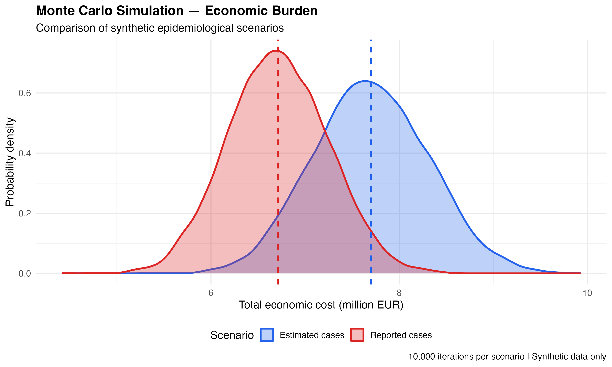{#fig-monte-carlo-distribution fig-alt="Distribution synthétique des coûts économiques totaux hypothétiques obtenue par simulation de Monte-Carlo"}

#### Contributions des coûts directs et indirects

Dans la simulation de référence, les composantes de coûts directs représentaient environ **84,9 %** des coûts totaux modélisés, contre **15,1 %** pour les coûts indirects.

La @fig-monte-carlo-breakdown illustre la répartition des composantes économiques simulées.

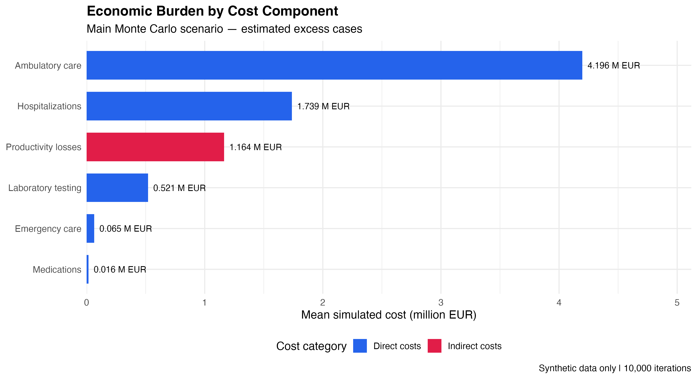{#fig-monte-carlo-breakdown fig-alt="Composition synthétique des coûts économiques directs et indirects"}

Les contributions relatives dépendent des hypothèses et des lois d'échantillonnage définies dans le modèle synthétique. Elles ne constituent pas une estimation empirique de la composition des coûts de la dengue.

#### Incertitude des paramètres d'entrée et analyse de sensibilité

Les paramètres d'entrée incertains et illustratifs comprenaient notamment des dépenses de santé ou des paramètres épidémiologiques suivant des lois normales, des durées d'hospitalisation et d'arrêt de travail suivant des lois triangulaires, ainsi que certaines dépenses de médicaments non remboursés suivant des lois uniformes.

La @fig-monte-carlo-inputs présente les distributions des paramètres d'entrée modélisées pour produire les résultats synthétiques.

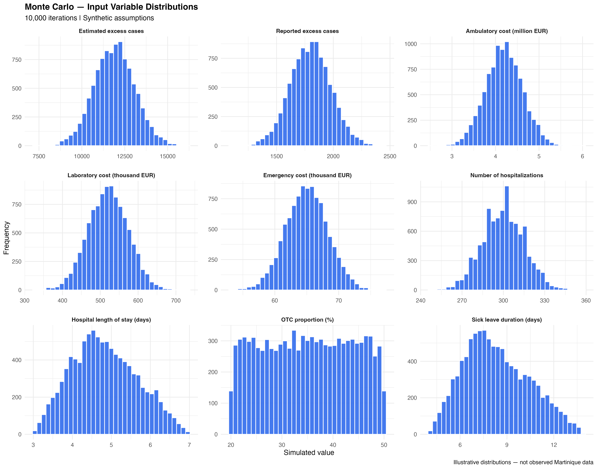{#fig-monte-carlo-inputs fig-alt="Distributions synthétiques des paramètres d'entrée du modèle de coût de la maladie par Monte-Carlo"}

Une analyse de sensibilité complémentaire, faisant varier un paramètre à la fois, a modifié certaines hypothèses économiques, notamment les niveaux de salaire et la durée des arrêts de travail, pour illustrer leur influence potentielle sur le coût total modélisé.

La @fig-monte-carlo-sensitivity résume les résultats illustratifs de cette analyse de sensibilité.

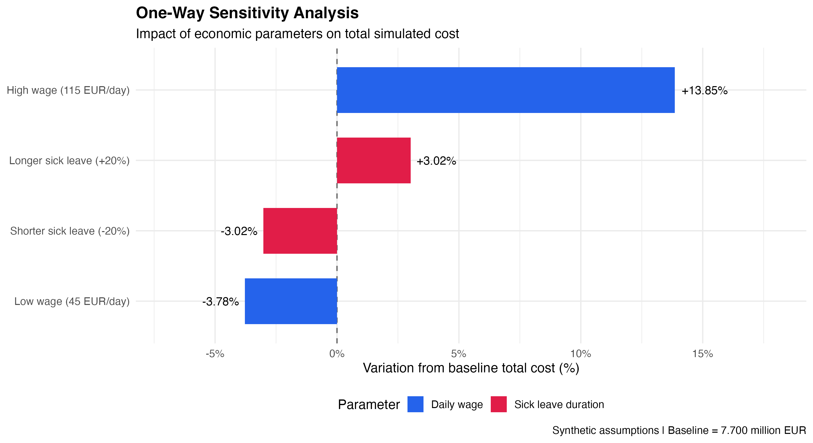{#fig-monte-carlo-sensitivity fig-alt="Analyse de sensibilité univariée synthétique des hypothèses du modèle de coût de la maladie"}

Le modèle de Monte-Carlo représente un **scénario économique hypothétique indépendant**. Ses résultats n'ont été ni calibrés sur les procédures synthétiques de remboursement, de pharmacie, de composantes épidémiologiques des coûts ou de laboratoire décrites précédemment, ni rapprochés de celles-ci. Leurs montants ne doivent donc **pas** être additionnés ni interprétés comme une estimation globale validée du fardeau de la maladie.

---

## Discussion

### Principaux enseignements méthodologiques

Cette étude de cas montre comment plusieurs tâches analytiques pertinentes pour la recherche épidémiologique et médico-économique peuvent être organisées en procédures documentées et reproductibles. En séparant la génération des données synthétiques, les règles de traitement, les indicateurs de synthèse, les visualisations et l'analyse de l'incertitude, le projet rend les choix méthodologiques explicites et vérifiables.

L'analyse épidémiologique simulée a illustré la différence entre **les totaux bruts par période**, **les comparaisons descriptives ajustées sur le nombre de semaines** et **les mesures individuelles**, qui ne peuvent être déduites de simples nombres agrégés de surveillance. Le module de remboursement administratif a montré comment les définitions des dates et les filtres d'éligibilité influent sur les synthèses financières. L'analyse pharmaceutique a illustré la classification et l'agrégation annuelle sans présumer d'une attribution clinique. Les modules consacrés aux laboratoires ont souligné la distinction entre volumes d'examens, recettes théoriques et conséquences des observations manquantes. Enfin, la simulation de Monte-Carlo a illustré la manière dont l'incertitude des hypothèses de modélisation se traduit par une distribution de coûts hypothétiques.

Pris ensemble, ces enseignements concernent **la conception analytique et la reproductibilité**, et non l'ampleur réelle de la morbidité ou des dépenses liées à la dengue en Martinique.

### Comparabilité épidémiologique et définition des indicateurs

Les périodes de l'étude de cas ont été sélectionnées comme exemples analytiques, et non comme limites épidémiques vérifiées. P1 et P2 couvrant 47 semaines, contre 31 semaines pour P3, la comparaison directe des valeurs cumulées peut être trompeuse. La comparaison des moyennes par semaine observée tient partiellement compte de la durée, mais ne supprime pas les différences de saisonnalité, de détection des cas, de dynamique de transmission ou de couverture temporelle.

En outre, les CCE estimés, les confirmations biologiques, les passages aux urgences et les hospitalisations résultent de processus d'observation distincts. Ils ne doivent pas être présentés comme des mesures interchangeables de l'incidence ni comme des parcours individuels de patients reliés entre eux, en l'absence de données appropriées à l'échelle des personnes.

De même, les figures comparatives de maladies normalisées visent à représenter **la forme temporelle relative** des courbes, et non les différences de fardeau entre maladies. Chaque série est mise à l'échelle indépendamment ; des hauteurs égales sur les graphiques n'impliquent donc pas des nombres de cas identiques.

### Implications pour les données administratives et les données de laboratoire

Les analyses financières nécessitent une définition rigoureuse de la perspective de mesure. Les prestations enregistrées à la date de remboursement peuvent différer des coûts affectés à la date de réalisation des soins. La classification, les règles d'exclusion, la pondération géographique et le traitement des données manquantes peuvent tous modifier les montants agrégés obtenus.

Il convient également de distinguer **les remboursements**, **les recettes des laboratoires**, **les coûts sous-jacents des ressources mobilisées** et **les pertes de productivité**. Ces grandeurs correspondent à des concepts économiques différents ; les additionner directement exposerait à des doubles comptes ou au mélange de perspectives comptables incompatibles.

Dans les exemples relatifs aux laboratoires, la conservation des effectifs inconnus comme valeurs manquantes a permis d'éviter que l'absence d'information ne devienne artificiellement une absence d'activité. Le scénario fictif de sous-traitance montre également que les hypothèses opérationnelles peuvent influencer l'interprétation graphique, sans fournir de preuve concernant des établissements réels.

### Incertitude économique et interprétation du modèle

La modélisation probabiliste du coût de la maladie est utile pour explorer les conséquences de paramètres d'entrée incertains. Toutefois, la précision apparente des simulations ne compense pas l'absence de validation des valeurs d'entrée. L'intervalle central de simulation à 95 % présenté décrit la variabilité au sein du modèle synthétique, et non l'incertitude entourant un coût observé à l'échelle d'une population.

Une étude médico-économique en conditions réelles nécessiterait une perspective et un horizon temporel clairement définis, une unité d'analyse cohérente, une attribution justifiée du recours aux soins à la dengue, des distributions calibrées, des conventions de valorisation documentées ainsi qu'une prise en compte des dépendances entre composantes de coûts. Les analyses de sensibilité et de scénarios devraient ensuite être interprétées au regard de la qualité des données empiriques, et non seulement du comportement mathématique du modèle.

### Points forts de la démonstration

Le projet propose une chaîne d'analyse R multimodulaire et vérifiable, des jeux de données synthétiques qui évitent la redistribution de documents institutionnels à accès restreint, plusieurs types de visualisations, des synthèses numériques explicites et des contrôles automatisés de qualité des données. Les figures et tableaux publics peuvent être examinés sans accès aux données confidentielles de surveillance ou de soins.

Cette étude de cas illustre également l'intérêt de Quarto pour réunir les méthodes, les résultats du code, les définitions mathématiques et l'interprétation scientifique dans un même rapport structuré.

### Limites

Plusieurs limites sont inhérentes à la finalité de ce travail :

- **Données d'entrée synthétiques :** tous les résultats numériques dépendent d'hypothèses fictives de génération des données et ne peuvent être généralisés aux patients, aux services de soins ou aux budgets de santé en Martinique.
- **Modules indépendants :** les analyses de remboursement, de pharmacie, de laboratoire et de simulation probabiliste ne constituent pas un modèle économique intégré et validé.
- **Comparaisons descriptives :** les différences entre périodes prédéfinies ne démontrent ni un excès causal de cas ni des dépenses attribuables à la dengue.
- **Informations agrégées :** aucun appariement de personnes uniques entre les données de surveillance, les urgences, les hospitalisations et les enregistrements pharmaceutiques n'était disponible ni recherché.
- **Allocations illustratives :** les distributions par âge, coefficients géographiques, tarifs de soins et paramètres des modèles n'ont pas été estimés empiriquement pour la population cible.
- **Portabilité incomplète :** certains scripts sources peuvent nécessiter une adaptation des chemins locaux et une documentation supplémentaire des dépendances pour être exécutés sur un autre ordinateur.
- **Figures statiques du rapport :** le rapport fait référence à des figures exportées par des scripts d'analyse distincts ; leur régénération nécessite l'exécution de ces scripts avec les données synthétiques, dans l'ordre documenté.

### Développements futurs

Les prochaines priorités de développement consistent à documenter plus précisément les dépendances logicielles et l'ordre d'exécution, à supprimer les chemins de fichiers propres à un environnement, à standardiser les contrôles automatisés de validation et à améliorer la régénération complète des figures et des tableaux. Des développements supplémentaires pourraient comprendre des tests unitaires, des rapports Quarto paramétrés et des visualisations interactives clairement distinctes des analyses principales.

Toute application ultérieure à des données réelles nécessiterait une gouvernance appropriée, des autorisations d'accès, une validation et un plan d'analyse statistique et économique propre à l'étude. Cette démonstration ne confère aucune autorisation de réutiliser des données institutionnelles originales.

---

## Conclusion

Cette étude de cas synthétique présente un cadre reproductible d'analyse descriptive de la surveillance de la dengue, du recours aux soins, des remboursements administratifs, des dépenses pharmaceutiques, de l'activité diagnostique des laboratoires et de scénarios économiques probabilistes.

Sa principale contribution est méthodologique : elle montre comment la programmation statistique, la définition explicite des indicateurs, le prétraitement structuré, les contrôles qualité, la présentation graphique et les analyses de sensibilité peuvent soutenir une recherche épidémiologique et médico-économique transparente.

Bien que le projet utilise un scénario de dengue situé en Martinique, **aucun de ses résultats numériques ne constitue un constat de surveillance observé ni une estimation validée du fardeau économique local de la dengue**. Les différents modules synthétiques doivent être interprétés comme des démonstrations analytiques et non additionnés pour obtenir une estimation unique des dépenses attribuables à la maladie.

Ce travail constitue une base de portfolio permettant d'améliorer encore la reproductibilité et, sous réserve d'une gouvernance et d'un protocole d'étude appropriés, d'appliquer à l'avenir des méthodes comparables à des données de recherche utilisées avec autorisation.

---

## Disponibilité du code et reproductibilité

Le dépôt du projet est accessible à l'adresse suivante :

**[Analyse médico-économique de la dengue — GitHub](https://github.com/MNNGT/dengue-medico-economic-analysis)**

Le code source est organisé dans le répertoire `R/`. Les figures et les tableaux de synthèse se trouvent dans `outputs/figures/` et `outputs/tables/`. Le fichier source de ce rapport français se trouve dans `reports/scientific_case_study.fr.qmd`.

Les jeux de données intermédiaires synthétiques sont générés localement et exclus du suivi de version. Aucun jeu de données original de surveillance, dossier de patient ou tableur institutionnel à accès restreint n'est nécessaire pour consulter les figures publiées et les synthèses méthodologiques présentées.

**Génération du rapport :** Une fois Quarto installé, exécuter la commande suivante à la racine du dépôt, après avoir généré les figures nécessaires :

```bash
quarto render reports/scientific_case_study.fr.qmd --to html
```

Le fichier produit est `reports/scientific_case_study.fr.html`. Le format HTML utilise `embed-resources: true` afin d'intégrer les images du rapport et les ressources web associées, ce qui facilite le partage et la lecture locale.

---

## Références

1. Organisation mondiale de la Santé. (21 août 2025). *Dengue*. [Fiche d'information de l'OMS](https://www.who.int/news-room/fact-sheets/detail/dengue-and-severe-dengue).
2. L'Assurance Maladie. (s. d.). *Études et données : Données ouvertes*, dont Open Damir. [Catalogue officiel des données](https://www.assurance-maladie.ameli.fr/etudes-et-donnees/donnees/liste-donnees-open-data).
3. L'Assurance Maladie. (21 avril 2026). *Open Medic : Base complète sur les dépenses de médicaments — 2014 à 2025*. [Description officielle des données](https://www.assurance-maladie.ameli.fr/etudes-et-donnees/open-medic-base-complete-depenses-medicaments).
4. Quarto. (s. d.). *Publishing HTML: Standalone HTML*. [Documentation officielle de Quarto](https://quarto.org/docs/output-formats/html-publishing).

*Les références 2 et 3 décrivent les familles de données publiques ayant inspiré les procédures de traitement synthétique. Le projet public ne contient aucun enregistrement original issu d'Open Damir ou d'Open Medic. Ces références fournissent un contexte et une documentation, et ne constituent pas les sources des résultats numériques simulés.*
