---
title: "A Reproducible Framework for Epidemiological and Medico-Economic Analysis of Dengue in Martinique"
subtitle: "A Synthetic Data Case Study"
author: "Marie-Noëlle Nogeant"
date: "2026-11-14"
format:
  html:
    theme: cosmo
    toc: true
    toc-depth: 3
    number-sections: true
    code-fold: true
    embed-resources: true
execute:
  echo: false
  warning: false
  message: false
---

::: {.callout-important}
## Data and Research Disclaimer

This report is an independent methodological demonstration based entirely on synthetic data and illustrative economic assumptions.

It does not reproduce confidential surveillance datasets, actual patient records, institutional findings, or validated estimates of dengue-related costs in Martinique.

The synthetic analytical workflows are inspired by methods developed during a public health research internship at Santé publique France, Antilles. This document is not an official institutional publication.
:::

## Abstract {.unnumbered}

**Background:** Dengue epidemics create important challenges for public health surveillance, healthcare resource planning, and economic evaluation. Quantifying their potential impact requires the integration of epidemiological indicators, healthcare utilization data, and economic information.

**Objective:** This study demonstrates a reproducible analytical framework for exploring the epidemiological and medico-economic dimensions of dengue using synthetic datasets.

**Methods:** Nine R scripts organized into five analytical modules were developed to illustrate epidemiological surveillance, healthcare reimbursement processing, pharmaceutical expenditure analysis, laboratory activity assessment, and probabilistic cost-of-illness modeling. The analytical framework includes descriptive statistics, comparisons between epidemiological periods, age-stratified healthcare utilization, data quality assessment, and Monte Carlo simulations.

**Results:** In the synthetic epidemic-period scenario, the workflows generated 17,913 estimated clinically suspected cases, 2,184 emergency-department visits, and 440 hospital admissions. A separate 10,000-iteration hypothetical cost-of-illness simulation yielded a mean total cost of EUR 7.700 million and a central 95% simulation interval of EUR 6.537–8.911 million. These independent outputs are not components of a validated integrated burden estimate.

**Conclusion:** This case study demonstrates how statistical programming, epidemiological methods, healthcare data processing, and uncertainty analysis can support a structured medico-economic research workflow. The results are methodological illustrations and cannot be generalized to the actual dengue burden in Martinique.

**Keywords:** Dengue; Epidemiology; Public Health; Health Economics; Cost-of-Illness; Monte Carlo Simulation; Reproducible Research; R; Synthetic Data.

---

## Introduction

Dengue is a mosquito-borne viral infection of major public health relevance in tropical and subtropical regions (World Health Organization, 2025).

Epidemiological surveillance is essential for describing temporal variations in disease activity, identifying periods of increased transmission, and monitoring pressures on healthcare services.

Beyond epidemiological indicators, dengue epidemics raise important questions about healthcare utilization, diagnostic testing, pharmaceutical expenditure, hospitalization, and productivity losses.

A medico-economic approach aims to examine these complementary dimensions within a structured analytical framework.

However, the interpretation of healthcare and epidemiological data requires careful attention to data quality, indicator definitions, differences in observation periods, and uncertainty in economic assumptions.

The present case study builds on analytical methods developed during public health research training and applies them to entirely synthetic datasets.

Rather than producing empirical estimates of dengue burden, its purpose is to demonstrate the organization, implementation, validation, and scientific communication of reproducible epidemiological and economic analyses.

### Research Objectives

The objectives of this methodological case study are to:

1. Describe synthetic dengue surveillance patterns across selected epidemiological periods.
2. Compare descriptive indicators of dengue-related healthcare utilization.
3. Demonstrate the processing of synthetic healthcare and pharmaceutical reimbursement datasets.
4. Explore diagnostic laboratory activity and illustrative economic components.
5. Quantify uncertainty in fictional cost-of-illness scenarios through Monte Carlo simulations.
6. Present the analytical methods and results in a reproducible scientific reporting format.

---


## Materials and Methods

### Study Design

This project was designed as a reproducible methodological case study using entirely synthetic epidemiological and economic datasets.

The analytical framework was developed to demonstrate the principal stages of a medico-economic research workflow, from data generation and preprocessing to descriptive epidemiological analysis, healthcare expenditure assessment, probabilistic modeling, and scientific reporting.

The study does not involve actual patients or original institutional surveillance observations. All publicly reported numerical results are generated from simulated datasets or illustrative assumptions.

The analytical framework comprises five complementary modules implemented through nine R scripts:

1. Epidemiological surveillance and healthcare utilization analysis.
2. Healthcare reimbursement analysis using a synthetic OpenDamir workflow.
3. Pharmaceutical expenditure analysis using synthetic OpenMedic-style records.
4. Diagnostic laboratory activity and cost analysis.
5. Probabilistic cost-of-illness modeling using Monte Carlo simulation.

The modules are independent methodological demonstrations rather than components of a single validated economic estimation model.

### Data Sources and Synthetic Data Generation

Synthetic datasets were generated using R to reproduce selected structural characteristics of epidemiological surveillance, healthcare reimbursement, laboratory activity, and economic data.

The data generation procedures were designed to create plausible analytical structures without reproducing actual epidemiological observations or confidential research datasets.

The simulated datasets include:

- Weekly epidemiological indicators for dengue and selected respiratory infections.
- Emergency-department visits and hospital admissions.
- Synthetic age-specific healthcare utilization.
- Monthly healthcare reimbursement records.
- Pharmaceutical dispensing and reimbursement records.
- Laboratory testing volumes and illustrative financial information.
- Economic input parameters for probabilistic simulations.

Random seeds were used in the analytical workflows to support reproducibility.

Intermediate datasets are generated locally and excluded from the public Git repository. The repository instead provides source scripts, analytical summaries, quality-control outputs, and visualizations.

### Epidemiological Surveillance Analysis

#### Surveillance Indicators

The epidemiological analysis distinguishes between several surveillance indicators.

The principal dengue indicator is the estimated number of clinically suspected dengue cases, referred to as clinically evocative cases (CCE), obtained from a simulated extrapolated sentinel surveillance series.

Additional synthetic indicators include:

- Raw sentinel consultation counts.
- Biologically confirmed dengue cases.
- Probable dengue cases.
- Emergency-department visits associated with dengue.
- Hospital admissions associated with dengue.

Confirmed and probable cases were considered separately from estimated CCE because the indicators represent different surveillance concepts and ascertainment processes.

The analysis also includes fictional influenza, COVID-19, and bronchiolitis indicators for comparative visualization.

#### Study Period Definition

Three illustrative study periods were defined using ISO calendar weeks.

| Study period | Time window | Duration |
|---|---|---:|
| P1 — Reference period | 2022 W30–2023 W24 | 47 weeks |
| P2 — Epidemic scenario | 2023 W30–2024 W24 | 47 weeks |
| P3 — Additional reference period | 2025 W18–W48 | 31 weeks |

P1 and P2 have identical durations, permitting direct descriptive comparison of their cumulative simulated indicators.

P3 contains fewer observation weeks. Consequently, weekly averages were also calculated when comparing P3 with the other periods.

A supplementary comparative surveillance workflow additionally evaluates alternative strict study windows comprising 36 weeks for P1 and P2, while preserving the 31-week P3 comparison period.

These study periods are illustrative analytical windows and do not establish actual epidemic boundaries.

#### Descriptive Epidemiological Analysis

Weekly surveillance indicators were aggregated by study period.

For each period, the analyses calculated:

- Total estimated clinically suspected cases.
- Total confirmed and probable cases.
- Emergency-department visits.
- Hospital admissions.
- Average weekly activity.
- Absolute differences between periods.
- Differences between weekly averages.


The primary descriptive comparison was defined as:

$$
\Delta_{P2-P1} = Y_{P2} - Y_{P1}
$$

where $Y$ represents the cumulative value of a selected synthetic epidemiological indicator.

To account descriptively for differences in period duration, weekly average differences were computed as:

$$
\Delta_{\mathrm{weekly}} =
\frac{Y_{P2}}{n_{P2}} -
\frac{Y_{P1}}{n_{P1}}
$$

where $n$ represents the number of observed weeks in each period.


These calculations describe differences between synthetic series and do not constitute causal estimates of disease-attributable excess burden.

### Comparative Infectious Disease Dynamics

Temporal patterns were compared across dengue, influenza, COVID-19, and bronchiolitis.

A centered three-week moving average was applied to smooth short-term variation in the simulated weekly series.

For graphical comparisons, each smoothed disease indicator was independently transformed using min–max normalization:

$$
Z_t = \frac{X_t - X_{\min}}{X_{\max} - X_{\min}}
$$

where $X_t$ represents a smoothed weekly observation and $X_{\min}$ and $X_{\max}$ represent the minimum and maximum values of the corresponding series.

This transformation was used to compare relative temporal patterns rather than absolute case counts.

Two alternative dengue indicators were visualized separately:

1. Estimated clinically suspected dengue cases.
2. Combined biologically confirmed and probable dengue cases.

The analysis therefore avoids interpreting normalized indicator values as equivalent disease incidence measures. The synthetic reconstruction of the comparative multi-disease visualization requested during the internship is presented in @fig-spf-superposition.

### Healthcare Utilization and Age-Stratified Analysis

Synthetic healthcare utilization was evaluated using emergency-department visits and hospital admissions.

Five age groups were considered:

- Under 5 years.
- 5–14 years.
- 15–44 years.
- 45–64 years.
- 65 years and older.

Weekly simulated healthcare encounters were allocated across these groups using multinomial sampling with predefined fictional probabilities and fixed random seeds.

The allocation procedures preserved the total number of simulated encounters for each week.

Age-stratified counts and proportions were then calculated for each study period.

Consistency checks verified that the sum of age-specific encounters matched the corresponding total number of emergency visits or hospital admissions.

These encounters do not necessarily represent unique patients, and the age distributions do not reflect observed demographic characteristics of dengue patients in Martinique.

#### Descriptive Hospitalization Indicators

Three aggregate hospitalization ratios were calculated using alternative denominators:

$$
R_{CCE} =
\frac{\text{Hospital admissions}}{\text{Estimated CCE}}
\times 100
$$

$$
R_{\mathrm{confirmed}} =
\frac{\text{Hospital admissions}}{\text{Confirmed cases}}
\times 100
$$

$$
R_{\mathrm{emergency}} =
\frac{\text{Hospital admissions}}{\text{Emergency visits}}
\times 100
$$

These ratios were retained as descriptive indicators because the different numerators and denominators may not represent linked observations from the same individuals.

They should therefore not be interpreted as patient-level probabilities or clinical hospitalization risks.

### Healthcare Reimbursement Analysis: OpenDamir

A synthetic healthcare reimbursement workflow was developed to illustrate the processing of large administrative datasets.

The workflow generated 25 monthly reimbursement files and applied a standardized series of processing operations.

These included:

- Selective variable import.
- Geographic and ambulatory care filtering.
- Classification of healthcare service codes.
- Identification of negative reimbursement values.
- Tracking of exclusions and data quality.
- Temporal alignment of care and reimbursement dates.
- Aggregation of expenditure across selected periods.

Nineteen healthcare service codes were classified into four analytical categories.

Three complementary approaches to reimbursement aggregation were compared:

**Full-flow approach:** Inclusion of eligible reimbursements recorded within the selected monthly extracts.

**Strict care-period approach:** Restriction to care delivered during the corresponding analytical period.

**Cumulative approach:** Inclusion of eligible care from the current and specified preceding periods to account for simulated reimbursement delays.

Illustrative territorial weighting coefficients were also applied to demonstrate the potential influence of geographical allocation assumptions.

The selected reimbursement categories do not independently establish whether healthcare expenditure was attributable to dengue.

### Pharmaceutical Expenditure Analysis: OpenMedic

A complementary pharmaceutical reimbursement workflow was implemented using synthetic dispensing and reimbursement records.

The analysis included:

- Generation of synthetic pharmaceutical observations.
- Classification of records using Anatomical Therapeutic Chemical (ATC) codes.
- Filtering and aggregation of pharmaceutical reimbursement information.
- Calculation of annual pharmaceutical expenditure.
- Comparison between selected study years.
- Application of illustrative geographical allocation coefficients.

Annual summaries and graphical representations were produced to demonstrate reproducible pharmaceutical expenditure reporting.

The synthetic reimbursement amounts were not interpreted as observed dengue-related pharmaceutical costs.

### Laboratory Diagnostic Activity and Economic Analysis

Two complementary laboratory workflows were developed.

#### Diagnostic Testing Activity and Laboratory Revenue

The first laboratory analysis evaluated simulated diagnostic testing activity covering selected periods between 2022 and 2025.

The diagnostic categories included:

- Dengue PCR testing.
- NS1 antigen testing.
- Dengue serology, including IgG and IgM.

Monthly test volumes were aggregated by diagnostic category and study period.

Illustrative theoretical laboratory revenue was calculated using simulated testing activity and tariff assumptions.

Consistency checks were performed between simulated financial values and theoretical calculations.

Comparisons between study periods included average monthly testing volumes to account for differences in observation duration.

Laboratory revenue was treated as a distinct financial measure and was not assumed to be equivalent to health insurance reimbursement or total healthcare cost.

#### Local and Outsourced Laboratory Testing

The second workflow examined the organization of synthetic laboratory testing between local and outsourced diagnostic services.

The simulated data covered 42 months and distinguished several diagnostic categories, including blood PCR, cerebrospinal fluid PCR, NS1 antigen testing, and IgG serology.

The analysis focused on:

- Monthly diagnostic testing activity.
- Differences between local and outsourced services.
- Comparisons across study periods.
- Data completeness.
- Identification of unavailable observations.
- Illustrative operational interruptions.

Unavailable observations were preserved as missing values rather than being systematically converted to zero.

This distinction was used to demonstrate the importance of separating missing information from a genuine absence of diagnostic activity.

All operational scenarios were fictional.

### Probabilistic Cost-of-Illness Analysis

A probabilistic cost-of-illness simulation was developed to illustrate the propagation of uncertainty through an economic evaluation framework.

The modeling workflow distinguished two broad economic components:

**Direct costs:** Illustrative healthcare expenditure associated with ambulatory care, hospitalization, emergency services, pharmaceutical treatment, and diagnostic testing.

**Indirect costs:** Illustrative productivity losses associated with work absence and related assumptions.

The model applied probability distributions to selected uncertain input parameters.

These included:

- Normal distributions for selected healthcare expenditure and epidemiological inputs.
- Triangular distributions for hospital stays and work absence durations.
- Uniform distributions for selected non-reimbursed pharmaceutical expenditure assumptions.

A total of **10,000 Monte Carlo iterations** were performed.

For each simulation, total economic cost was derived from the modeled direct and indirect components.

The simulated cost distribution was summarized using descriptive statistics and a central 95% simulation interval.

Complementary sensitivity analyses examined the influence of selected assumptions, including wage levels and sick leave durations.

The cost-of-illness simulation is an independent hypothetical scenario and is not an integrated estimate obtained by summing outputs from all other analytical modules.

### Data Quality and Reproducibility

Data processing and validation procedures were incorporated throughout the analytical workflows.

Depending on the module, these procedures included:

- Verification of expected dataset dimensions.
- Identification of missing or invalid observations.
- Validation of temporal variables and ISO-week definitions.
- Verification of study-period durations.
- Comparison of aggregate and stratified totals.
- Assessment of reimbursement processing exclusions.
- Comparison of theoretical and simulated laboratory financial values.
- Automated generation of summary tables and visualizations.

The analyses were implemented in R, using packages including `dplyr`, `tidyr`, `data.table`, `ggplot2`, and `patchwork`.

Source code, selected outputs, and technical documentation are available in the project repository.

The reporting workflow uses Quarto to generate a structured HTML research report.

Some analytical scripts still require local path adjustments and further dependency documentation before the complete repository can be considered portable across computing environments.

### Statistical Interpretation

All findings were interpreted descriptively within the synthetic scenarios.

No statistical inference about the population of Martinique was attempted, and no causal interpretation was assigned to differences between the illustrative study periods.

The purpose of the analyses was to demonstrate research methodology, transparent data processing, validation procedures, uncertainty quantification, and reproducible scientific communication.

---


## Results

All results presented in this section were generated from synthetic datasets and illustrative analytical assumptions. They demonstrate the application of the proposed methods and do not represent observed epidemiological or economic outcomes in Martinique.

### Epidemiological Surveillance and Case Counts

#### Temporal Patterns of Simulated Dengue Activity

The epidemiological dataset comprised 417 weekly observations covering the period from 2018 to 2025.

The simulated surveillance series was used to illustrate temporal variations in dengue activity and to compare three predefined analytical periods.

@fig-dengue-timeline presents the weekly evolution of estimated clinically suspected dengue cases (CCE), with the corresponding study periods highlighted.

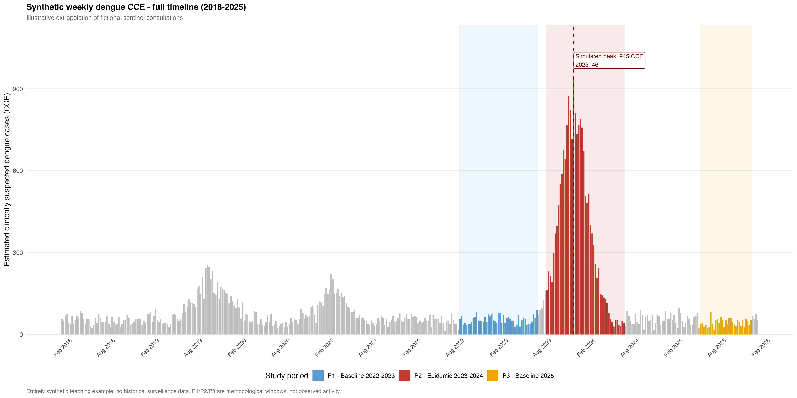{#fig-dengue-timeline fig-alt="Synthetic weekly dengue surveillance timeline with study-period shading"}

In the synthetic epidemic scenario (P2), the maximum weekly value reached **945 estimated CCE during ISO week 46 of 2023**.

This peak reflects the assumptions underlying the simulated epidemic curve and should not be interpreted as an observed dengue surveillance result.

#### Comparison Between Epidemiological Periods

Three analytical periods were considered:

| Period | Description | Duration |
|---|---|---:|
| P1 | Reference scenario, 2022–2023 | 47 weeks |
| P2 | Epidemic scenario, 2023–2024 | 47 weeks |
| P3 | Additional reference scenario, 2025 | 31 weeks |

The aggregation of synthetic surveillance data produced **17,913 estimated CCE during P2**.

The week-matched comparison between P2 and P1 yielded a net difference of **15,371 estimated CCE** in the simulated scenario.

These results demonstrate the calculation of differences between an illustrative epidemic period and a reference period.

However, the comparison is descriptive and does not provide a causal or statistically adjusted estimate of dengue-attributable excess cases.

Furthermore, P3 contains only 31 weeks, compared with 47 weeks for P1 and P2. Comparisons involving P3 must therefore account for the different observation durations.

@fig-period-counts illustrates the distribution of simulated case counts and healthcare utilization indicators across the study periods.

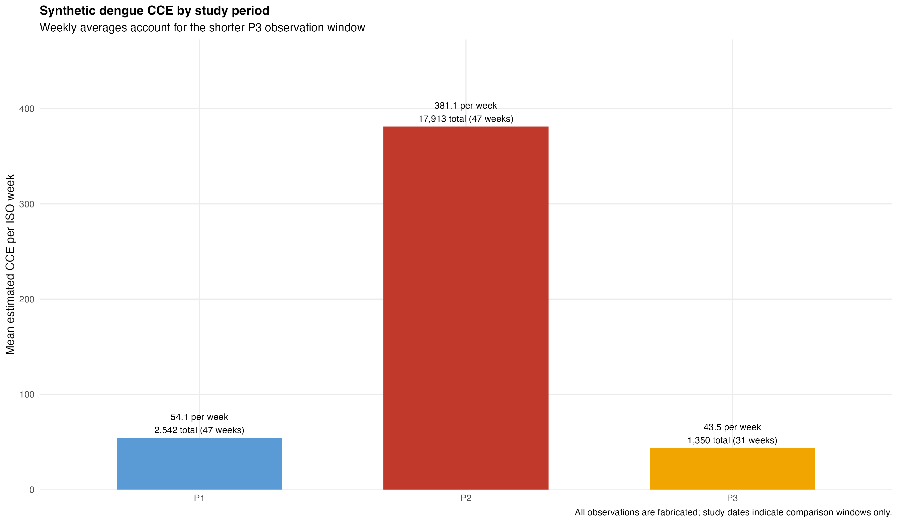{#fig-period-counts fig-alt="Synthetic dengue case counts and healthcare encounters across three study periods"}

#### Healthcare Utilization During the Synthetic Epidemic Period

The analysis also examined simulated healthcare encounters associated with dengue activity.

During P2, the dataset contained:

| Healthcare indicator | Synthetic P2 total |
|---|---:|
| Emergency-department visits | 2,184 |
| Hospital admissions | 440 |

These figures illustrate the aggregation of healthcare utilization indicators within the epidemic-period scenario.

Emergency-department visits and hospital admissions represent healthcare encounters rather than necessarily distinct individuals.

Consequently, their totals should not be combined to estimate the number of patients requiring medical care.

#### Age-Stratified Healthcare Utilization

Healthcare encounters were further distributed across five age groups using synthetic allocation probabilities.

The age categories were under 5 years, 5–14 years, 15–44 years, 45–64 years, and 65 years and older.

@fig-age-distribution presents the simulated age distribution of emergency-department visits and hospital admissions.

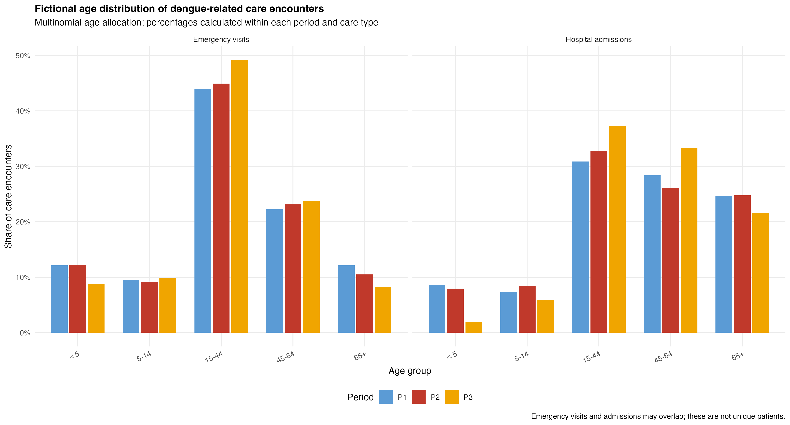{#fig-age-distribution fig-alt="Comparison of synthetic healthcare encounters by age group and study period"}

The age-stratification procedure preserved the total number of simulated healthcare encounters.

This was verified through automated reconciliation checks comparing age-specific sums with the corresponding aggregate totals.

The resulting distributions demonstrate the implementation of stratified descriptive analysis but do not reflect the actual age distribution of dengue-related healthcare utilization in Martinique.

#### Supplementary Surveillance Comparisons

A complementary workflow analyzed **208 synthetic weekly observations covering 2022–2025** to demonstrate comparative visualization of dengue, influenza, COVID-19, and bronchiolitis.

Dengue was represented using two distinct surveillance measures: simulated extrapolated clinically suspected cases and simulated biologically confirmed plus probable cases. Separate visualizations were used to avoid treating those indicators as interchangeable.

The analysis compared a **long-window specification** (47 weeks for P1 and P2) with a **strict-window specification** (36 weeks for P1 and P2); P3 remained 31 weeks in both specifications. A centered three-week moving average and indicator-specific min–max scaling facilitated comparison of the relative timing and shape of fictional disease curves.

#### Comparative Epidemic Curves — Requested Visualization (Synthetic Reconstruction)

A comparative visualization of **dengue, influenza, COVID-19, and bronchiolitis** was requested during the public-health research internship. @fig-spf-superposition reproduces the methodological structure of that deliverable using **entirely synthetic observations**; it is not the original institutional figure and does not reproduce Santé publique France surveillance data.

The upper panel compares extrapolated clinically suspected dengue cases (CCE) with the three respiratory-disease indicators. The lower panel uses biologically confirmed plus probable dengue cases instead. All four disease series are displayed on a shared time axis within each panel; a centered three-week moving average and independent min–max normalization emphasize their relative temporal patterns. The illustrative **2023–2024 dengue epidemic scenario (P2)** is highlighted as one of the shaded study periods.

{#fig-spf-superposition fig-alt="Two synthetic comparative surveillance line charts for 2022–2025. Upper panel: dengue estimated clinically suspected cases (CCE), influenza, COVID-19 and bronchiolitis. Lower panel: dengue biologically confirmed and probable cases with the same respiratory infections. Illustrative study periods P1, P2 and P3 are shaded."}

The resulting visualizations are descriptive. Because the indicators have different meanings and the window lengths vary, their normalized heights and cumulative totals must not be interpreted as directly comparable incidence or observed disease burden.

#### Supplementary Descriptive Ratios

The case-count workflow also produced aggregate ratios comparing simulated hospital admissions with estimated CCE, biologically confirmed cases, and emergency-department visits. The ratios use alternative denominators and do not track individuals between surveillance and care settings. Accordingly, they illustrate the importance of numerator–denominator definitions rather than estimating the individual probability of hospitalization.

### Healthcare Reimbursement Analysis: OpenDamir

#### Data Processing and Quality Control

The synthetic OpenDamir workflow demonstrated the processing of administrative healthcare reimbursement records using a reproducible R pipeline.

**Twenty-five monthly synthetic datasets** were generated, comprising **37,500 initial records**. After the predefined geographic, administrative, and service-related filters were applied, **19,491 records** were retained.

The procedure included selective import, classification of healthcare service codes, identification of negative reimbursements, checks on completeness, and tracking of filtering decisions. **Nineteen service codes** were grouped into **four analytical categories**.

The substantial difference between the initial and retained record counts illustrates how definitions of an eligible analytical population affect administrative-data summaries. The number retained represents synthetic filter logic, not an estimate of eligible or dengue-attributable healthcare events.

#### Comparison of Reimbursement Aggregation Methods

Three approaches were compared in the simulated reimbursement records:

1. **Full-flow approach:** eligible reimbursements recorded in the selected monthly extracts.
2. **Strict care-period approach:** eligible reimbursements for care dates within the predefined analytical window.
3. **Cumulative approach:** eligible care from the current and specified preceding periods, illustrating the effect of reimbursement timing.

In the synthetic P2 epidemic-period scenario, the cumulative approach exceeded the strict care-period approach by **EUR 4,918.12**. The corresponding illustrative difference for the 2025 comparison period was **EUR 1,692.38**.

These discrepancies show how time-window definitions and administrative reimbursement lags can change expenditure summaries without representing any alteration in the actual clinical burden of disease.

@fig-opendamir-methods compares the results obtained from the alternative temporal aggregation approaches.

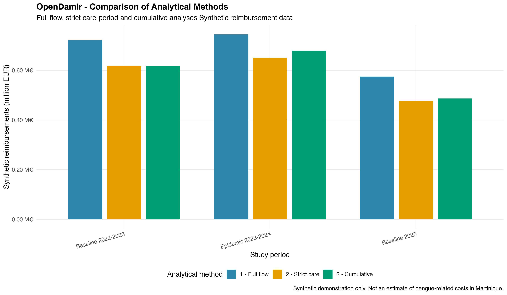{#fig-opendamir-methods fig-alt="Comparison of synthetic OpenDamir reimbursement aggregation methods"}

#### Territorial Weighting and Interpretation

Illustrative geographic weighting coefficients were applied to show how territorial allocation assumptions can influence reimbursement aggregates.

@fig-opendamir-weighting presents the corresponding simulated comparisons.

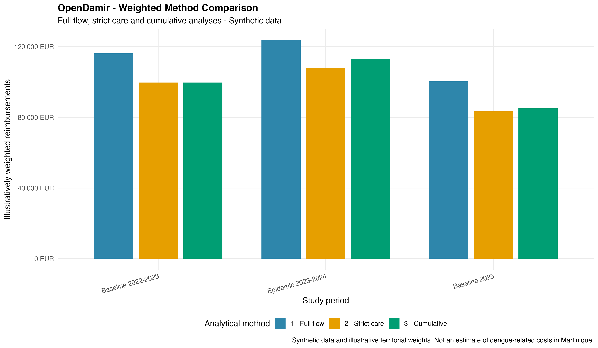{#fig-opendamir-weighting fig-alt="Synthetic OpenDamir reimbursement estimates with territorial weighting"}

Method choice and geographical assumptions both affect the reported synthetic totals. These administrative expenditure indicators cannot independently establish that the selected healthcare services were caused by dengue. The OpenDamir module is therefore a demonstration of reproducible reimbursement analysis, not an empirical dengue cost estimate.

### Pharmaceutical Expenditure Analysis: OpenMedic

#### Synthetic Pharmaceutical Reimbursement Data

The OpenMedic module implemented a reproducible workflow for generating and analyzing synthetic pharmaceutical dispensing and reimbursement records. It applied **Anatomical Therapeutic Chemical (ATC)** classification, record filtering, annual aggregation, and illustrative geographical allocation assumptions.

This approach mirrors broad analytical tasks that may arise with administrative pharmaceutical datasets, while using no original OpenMedic records in the public simulation.

#### Annual Pharmaceutical Expenditure

Synthetic reimbursement amounts were aggregated by year to produce descriptive expenditure summaries and compare simulated annual patterns.

@fig-openmedic-expenditure presents the annual reimbursement values produced by the pharmaceutical workflow.

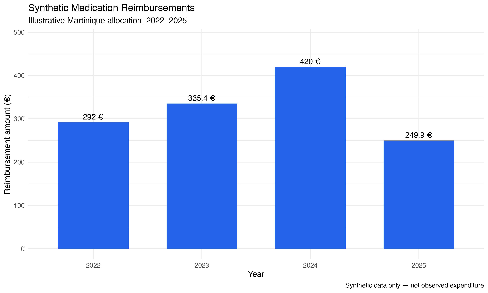{#fig-openmedic-expenditure fig-alt="Annual synthetic pharmaceutical reimbursement expenditure"}

The plotted variation reflects the assumptions used to generate the fictional observations. No numerical claim about observed drug spending in Martinique follows from this figure.

#### Methodological Interpretation and Limitations

Pharmaceutical reimbursement records may describe dispensing and expenditure, but they do not necessarily identify the indication for treatment. Therefore, a change in annual pharmaceutical spending cannot be assigned to dengue without additional disease-linkage information, eligibility definitions, and appropriate adjustments.

The regional allocation assumptions in this demonstration are not validated territorial cost estimates. The OpenMedic analysis remains an independent data-processing example, rather than an estimate of dengue-attributable medication costs.

### Diagnostic Laboratory Activity and Economic Analysis

#### Diagnostic Testing Volumes and Simulated Revenue

The first laboratory workflow reproduced the structure of diagnostic testing and revenue analysis with fully simulated records. It included **93 monthly test-category records** and **11,353 synthetic examinations**, distributed across diagnostic categories such as dengue PCR, NS1 antigen testing, and serology.

The principal comparison distinguished illustrative reference and epidemic-period scenarios. Average monthly activity was used so that periods of different durations could be discussed on a comparable descriptive basis.

| Synthetic study period | Average tests per month | Average laboratory revenue per month |
|---|---:|---:|
| Baseline 2022–2023 | 206 | EUR 5,434 |
| Epidemic scenario 2023–2024 | 618 | EUR 16,282 |
| Baseline 2025 | 210 | EUR 5,583 |

The simulated epidemic scenario generated approximately **three times** as many diagnostic examinations per month as the first baseline scenario. This is a programmed property of the fictional dataset, not a measurement of diagnostic demand in Martinique.

Across the full synthetic laboratory demonstration, the illustrative laboratory revenue was approximately **EUR 299,678**.

@fig-laboratory-volumes displays the synthetic temporal distribution of testing activity.

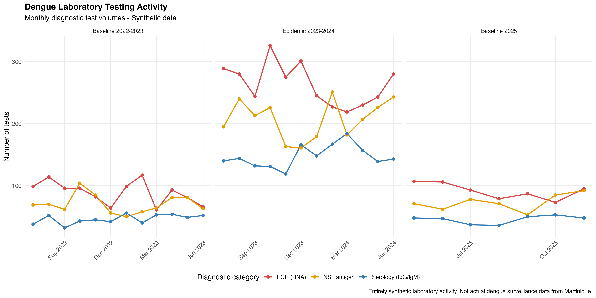{#fig-laboratory-volumes fig-alt="Monthly synthetic diagnostic laboratory testing volumes"}

@fig-laboratory-revenue presents the corresponding simulated laboratory revenue.

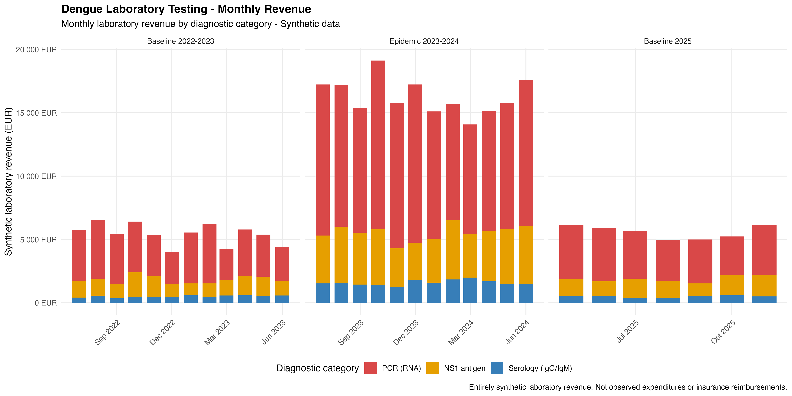{#fig-laboratory-revenue fig-alt="Monthly theoretical revenue associated with synthetic diagnostic testing"}

Revenue in this workflow is computed from fictional activity and tariff assumptions. It must not be equated with realized laboratory profit, health insurance reimbursement, or the total societal cost of dengue.

#### Local Versus Outsourced Testing and Missing Data

The second laboratory workflow analyzed a fictional diagnostic service pathway resembling local versus outsourced testing. It covered **42 months from June 2022 to November 2025**, with **336 source-level monthly records**, four diagnostic test categories, and two laboratory sources.

The diagnostic categories were blood PCR, cerebrospinal fluid PCR, NS1 antigen testing, and IgG serology. The simulation distinguished tests assigned to a local laboratory from those referred to an external service.

Several PCR entries for **September–December 2022** were deliberately unavailable. They were retained as missing observations, rather than replaced with zero, to avoid implying that no tests took place. The workflow also introduced an entirely **fictional outsourcing interruption in November 2023** as a test case for operational-data analysis.

@fig-laboratory-organization combines monthly trends and comparisons between local and outsourced synthetic diagnostic activity.

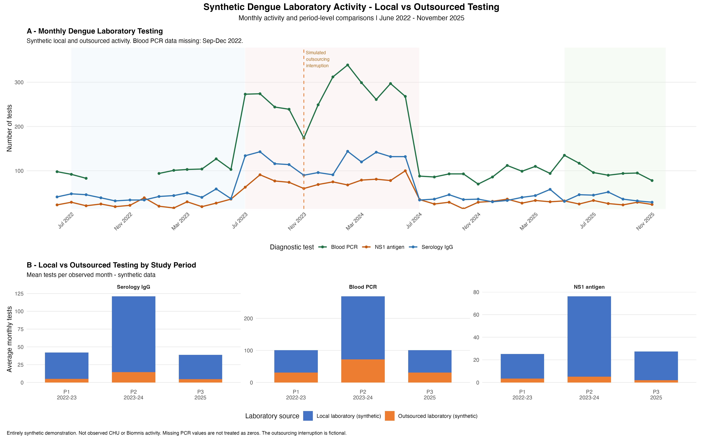{#fig-laboratory-organization fig-alt="Synthetic laboratory activity by month, diagnostic category and local or outsourced source"}

Neither the simulated interruption nor the observed differences in the figure document an actual operational event at the CHU of Martinique, Biomnis, or another laboratory. The two laboratory workflows are separate methodological exercises and are not pooled to estimate disease costs.

### Probabilistic Cost-of-Illness Analysis: Monte Carlo Simulation

#### Distribution of Hypothetical Economic Costs

The final module implemented **10,000 Monte Carlo iterations** to illustrate uncertainty propagation in a hypothetical cost-of-illness model.

The simulation distinguished direct healthcare costs from indirect productivity losses. Uncertain input parameters were assigned illustrative probability distributions, and a total cost was calculated for each simulation draw.

The baseline synthetic scenario produced the following summaries:

| Indicator | Result from synthetic simulation |
|---|---:|
| Number of iterations | 10,000 |
| Mean total cost | EUR 7.700 million |
| Median total cost | EUR 7.693 million |
| Central 95% simulation interval | EUR 6.537–8.911 million |
| Direct cost share | 84.9% |
| Indirect cost share | 15.1% |

The simulation interval describes the middle 95% of the **modeled fictional cost distribution**. It is not a confidence interval for an empirical estimate of dengue-related costs in Martinique.

@fig-monte-carlo-distribution displays the simulated distribution of economic outcomes.

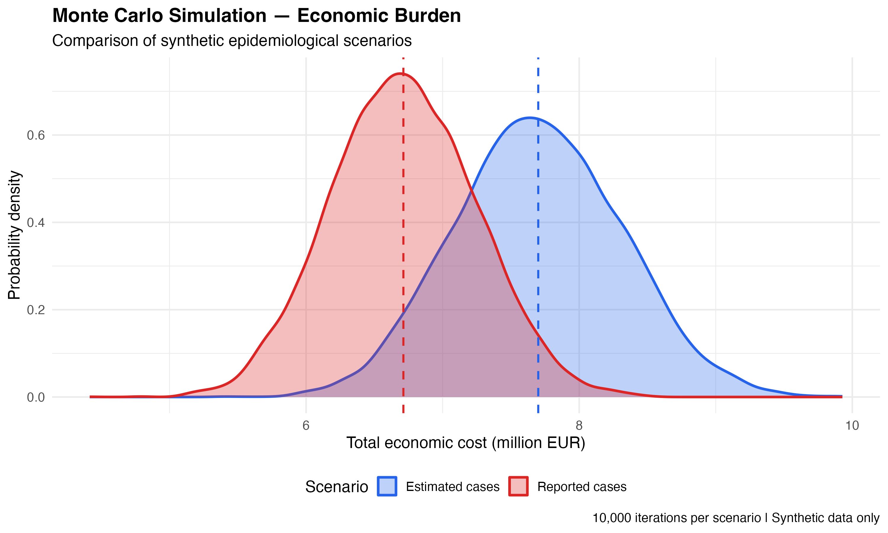{#fig-monte-carlo-distribution fig-alt="Synthetic Monte Carlo distribution of hypothetical total economic costs"}

#### Direct and Indirect Cost Contributions

In the baseline simulation, direct cost components represented approximately **84.9%** of total modeled costs, compared with **15.1%** for indirect costs.

@fig-monte-carlo-breakdown illustrates the distribution of the simulated economic components.

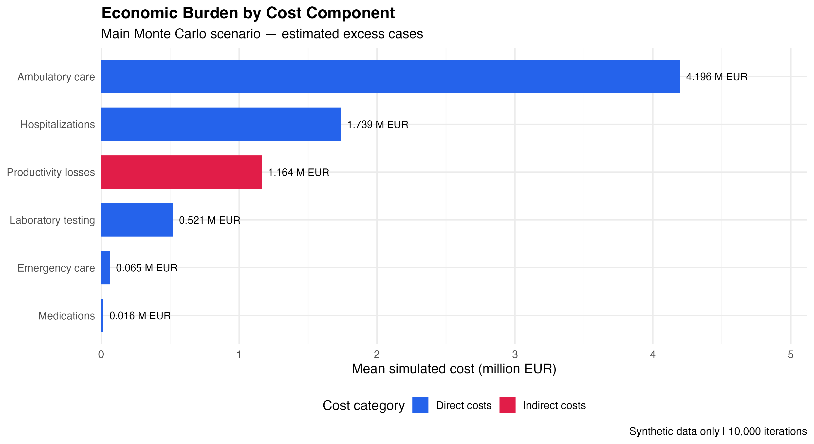{#fig-monte-carlo-breakdown fig-alt="Synthetic composition of direct and indirect economic costs"}

The relative contributions are determined by the assumptions and sampling distributions specified in the synthetic model. They do not provide an empirical estimate of the composition of dengue costs.

#### Input Uncertainty and Sensitivity Analysis

Illustrative uncertain inputs included normally distributed healthcare expenditure or epidemiological parameters, triangularly distributed lengths of hospital stays and work absence, and uniformly distributed selected non-reimbursed medication assumptions.

@fig-monte-carlo-inputs presents the modeled input distributions used to generate synthetic outcomes.

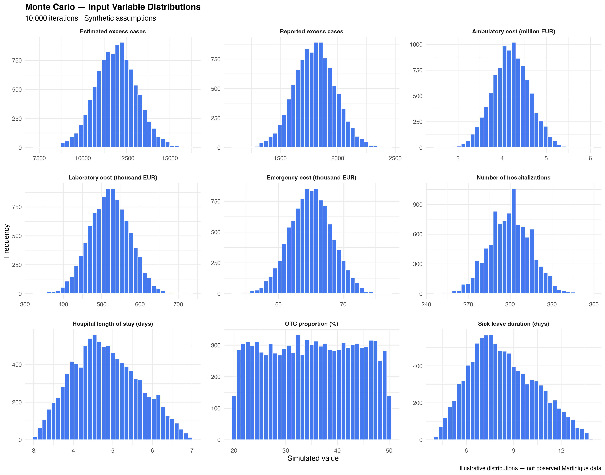{#fig-monte-carlo-inputs fig-alt="Synthetic input parameter distributions in the Monte Carlo cost-of-illness model"}

A complementary one-way sensitivity analysis varied selected economic assumptions, including wage levels and sick-leave duration, to illustrate their potential influence on the modeled total.

@fig-monte-carlo-sensitivity summarizes these illustrative sensitivity results.

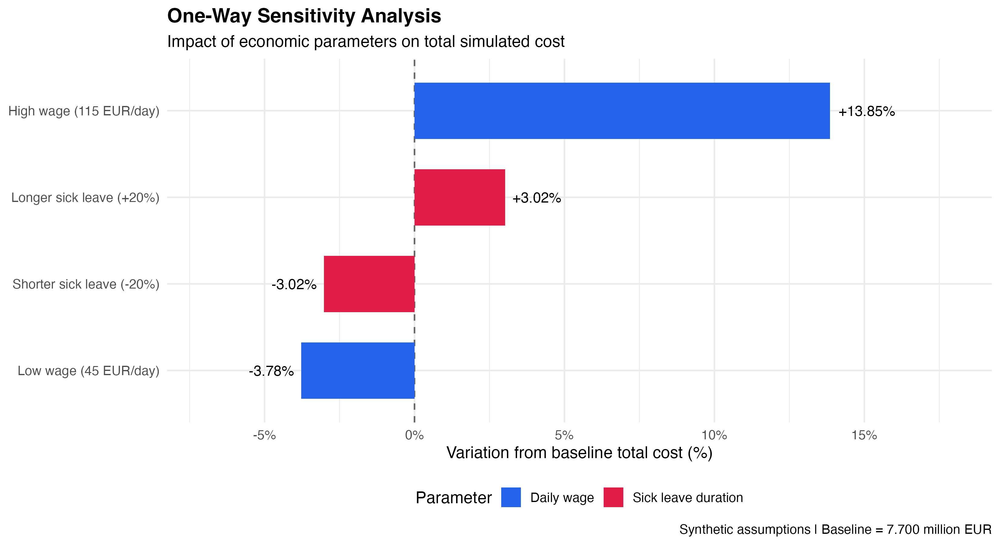{#fig-monte-carlo-sensitivity fig-alt="Synthetic one-way sensitivity analysis of cost-of-illness model assumptions"}

The Monte Carlo model is an **independent hypothetical economic scenario**. Its outputs have not been calibrated to, or reconciled with, the synthetic reimbursement, pharmaceutical, epidemiological cost-component, or laboratory workflows described above. Therefore, their numerical totals must **not** be added together or interpreted as a validated integrated burden estimate.

---

## Discussion

### Principal Methodological Findings

This case study demonstrates how several analytic tasks relevant to epidemiological and medico-economic research can be organized as documented, reproducible workflows. By separating synthetic data generation, processing rules, summary indicators, visualization, and uncertainty analysis, the project makes methodological decisions explicit and reviewable.

The simulated epidemiological analysis illustrated the difference between **raw period totals**, **week-adjusted descriptive comparisons**, and **patient-level measures**, which cannot be inferred from aggregate surveillance counts. The administrative reimbursement module showed how date definitions and eligibility filters affect financial summaries. The pharmaceutical analysis demonstrated classification and annual aggregation without presuming clinical attribution. The laboratory modules emphasized the distinction between diagnostic volume, theoretical revenue, and the consequences of missing observations. Finally, Monte Carlo simulation illustrated the translation of uncertain modeling assumptions into a distribution of hypothetical costs.

Taken together, these findings are about **analytical design and reproducibility**, not the real magnitude of dengue-related morbidity or expenditures in Martinique.

### Epidemiological Comparability and Indicator Definition

The case-study periods were selected as analytical examples rather than verified epidemic boundaries. Because P1 and P2 span 47 weeks while P3 spans 31 weeks, direct comparisons of their cumulative values can be misleading. Comparing means per observed week partially addresses duration but does not remove differences in seasonality, ascertainment, transmission dynamics, or temporal coverage.

Moreover, estimated clinically suspected cases, biological confirmations, emergency-department encounters, and hospital admissions arise from different observation processes. They should not be presented as interchangeable measures of incidence or as linked patient trajectories without appropriate person-level information.

The normalized comparative-disease figures are likewise intended to communicate **relative temporal shape**, not differences in disease-specific burden. Each series is scaled independently; therefore, equal plotted heights do not imply equal numbers of cases.

### Implications for Administrative and Laboratory Data

Financial analyses require careful definition of the measurement perspective. Claims recorded by reimbursement date may differ from costs allocated to the date of care. Classification, exclusion rules, geographical weighting, and missing-data treatment can all change the resulting aggregates.

A further distinction is needed between **reimbursement**, **laboratory revenue**, **underlying resource costs**, and **productivity losses**. These quantities represent different economic concepts; their direct addition would risk double counting or mixing incompatible accounting perspectives.

In the laboratory examples, preserving unknown counts as missing values helped prevent an absence of information from becoming an apparent absence of activity. The fictional outsourcing scenario also shows how operational assumptions can affect graphical interpretation, although it provides no evidence about real institutions.

### Economic Uncertainty and Model Interpretation

Probabilistic cost-of-illness modeling is useful for exploring the consequences of uncertain input assumptions. However, simulated precision does not compensate for unvalidated input values. The reported central 95% simulation interval characterizes variability within the synthetic model, not uncertainty around an observed population cost.

A real-world medico-economic study would require a clearly specified perspective and time horizon, a coherent unit of analysis, justified attribution of utilization to dengue, calibrated distributions, documented pricing conventions, and consideration of dependence among cost components. Sensitivity and scenario analyses would then be interpreted in relation to the quality of the empirical evidence, rather than only to mathematical model behavior.

### Strengths of the Demonstration

The project provides an auditable multi-module R workflow, synthetic datasets that avoid redistributing restricted institutional material, multiple visualization types, explicit numerical summaries, and automated data-quality checks. Public figures and tables can be reviewed without access to confidential surveillance or healthcare records.

The case study also illustrates the value of Quarto for integrating methods, code outputs, mathematical definitions, and scientific interpretation into one structured report.

### Limitations

Several limitations are fundamental to the purpose of this work:

- **Synthetic inputs:** all numerical findings depend on fictional data-generating assumptions and cannot be generalized to patients, healthcare services, or budgets in Martinique.
- **Independent modules:** the distinct reimbursement, pharmaceutical, laboratory, and probabilistic analyses do not form one validated integrated economic model.
- **Descriptive comparisons:** differences between predefined periods do not establish causal excess cases or dengue-attributable expenditure.
- **Aggregate information:** no linkage of unique people across surveillance, emergency care, hospitalization, and pharmaceutical records was available or intended.
- **Illustrative allocation:** age distributions, geographical coefficients, healthcare tariffs, and model parameters were not empirically estimated for the target population.
- **Incomplete portability:** some source scripts may require local path adjustments and additional dependency documentation for execution on a new computer.
- **Static reporting figures:** the report references figures exported by the separate analysis scripts; rebuilding them requires executing those scripts with the synthetic inputs in the documented order.

### Future Development

The next development priorities are to document software dependencies and execution order more explicitly, eliminate environment-specific file paths, standardize automated validation checks, and improve end-to-end regeneration of figures and tables. Additional work could include unit tests, parameterized Quarto reporting, and carefully separated interactive visualizations.

Any subsequent real-data application would require appropriate governance, access permissions, validation, and a study-specific statistical and economic analysis plan. Nothing in this demonstration grants permission to reuse original institutional data.

---

## Conclusion

This synthetic case study presents a reproducible framework for the descriptive analysis of dengue surveillance, healthcare utilization, administrative reimbursements, pharmaceutical spending, diagnostic laboratory activity, and probabilistic economic scenarios.

Its principal contribution is methodological: it demonstrates how statistical programming, explicit indicator definitions, structured preprocessing, quality checks, graphical reporting, and sensitivity analysis can support transparent epidemiological and medico-economic research.

Although the project uses a dengue scenario situated in Martinique, **none of its numerical outputs constitute observed surveillance findings or validated estimates of the local economic burden of dengue**. The separate synthetic modules should be interpreted as analytical demonstrations and not combined into a single disease-attributable expenditure estimate.

The work provides a portfolio-ready foundation for further reproducibility improvements and, subject to appropriate governance and study design, future application of similar methods to authorized research data.

---

## Code Availability and Reproducibility

The project repository is available at:

**[Dengue Medico-Economic Analysis — GitHub](https://github.com/MNNGT/dengue-medico-economic-analysis)**

The source code is organized in the `R/` directory. Figures and summary tables are located in `outputs/figures/` and `outputs/tables/`. This report's source file is located in `reports/scientific_case_study.qmd`.

Synthetic intermediate datasets are generated locally and excluded from version control. No original surveillance dataset, patient record, or restricted institutional spreadsheet is required to inspect the published figures and reported methodological summaries.

**Rendering:** With Quarto installed, run the following command from the repository root after the relevant figures have been generated:

```bash
quarto render reports/scientific_case_study.qmd --to html
```

The output is `reports/scientific_case_study.html`. The HTML format uses `embed-resources: true` to embed report images and associated web resources, facilitating sharing and local reading.

---

## References

1. World Health Organization. (2025, August 21). *Dengue*. [WHO fact sheet](https://www.who.int/news-room/fact-sheets/detail/dengue-and-severe-dengue).
2. L'Assurance Maladie. (n.d.). *Études et données: Données ouvertes*, including Open Damir. [Official data catalogue](https://www.assurance-maladie.ameli.fr/etudes-et-donnees/donnees/liste-donnees-open-data).
3. L'Assurance Maladie. (2026, April 21). *Open Medic: Base complète sur les dépenses de médicaments — 2014 à 2025*. [Official data description](https://www.assurance-maladie.ameli.fr/etudes-et-donnees/open-medic-base-complete-depenses-medicaments).
4. Quarto. (n.d.). *Publishing HTML: Standalone HTML*. [Official Quarto documentation](https://quarto.org/docs/output-formats/html-publishing).

*References 2 and 3 describe the public data families that inspired the synthetic processing workflows; the public project does not contain original Open Damir or Open Medic source records. References are background and documentation, not sources of the simulated numerical results.*
